# Wallfree – Bedienungsanleitung der Weboberfläche

Diese Anleitung beschreibt die Weboberfläche der Ladesteuerung mit der Firmware **Wallfree**:
Anmeldung, Anzeigen, alle einstellbaren Parameter und das Vorgehen bei Störungen.
Die elektrische Installation der Ladestation ist nicht Gegenstand dieser Anleitung.

> **Stand:** Vorabversion. Die Firmware ist in der PC-Simulation, auf einer Ladesteuerung
> ohne Last und an einer Ladestation mit einem Fahrzeug (einphasig, 16 A) geprüft; dreiphasiges
> Laden und andere Fahrzeuge nicht. Die Abbildungen stammen aus der PC-Simulation.

## Inhalt

1. [Sicherheitshinweise](#1-sicherheitshinweise)
2. [Voraussetzungen und Aufruf](#2-voraussetzungen-und-aufruf)
3. [Erste Anmeldung](#3-erste-anmeldung)
4. [Aufbau der Oberfläche](#4-aufbau-der-oberfläche)
5. [Übersicht](#5-übersicht)
6. [Status](#6-status)
7. [Einstellungen](#7-einstellungen)
8. [System](#8-system)
9. [Störungen und Abhilfe](#9-störungen-und-abhilfe)
10. [Anhang](#10-anhang)

---

## 1 Sicherheitshinweise

- Einstellungen unter **Einstellungen › Laden** greifen direkt in den Ladeablauf, die
  Verriegelung und die Überwachung ein. Ändern Sie sie nur, wenn Sie die Wirkung kennen und
  die Beschaltung der Ladestation dazu passt. Im Zweifel die Werkseinstellung belassen.
- Die Weboberfläche ersetzt keine Schutzeinrichtung. Fehlerstromschutz und
  Leitungsschutz der Installation müssen unabhängig davon vorhanden sein.
- Die Verbindung zur Steuerung ist **nicht verschlüsselt** (kein HTTPS). Betreiben Sie die
  Steuerung nur in einem vertrauenswürdigen Heimnetz und machen Sie sie nicht aus dem Internet
  erreichbar.
- Ändern Sie das Passwort des Werkszugangs bei der ersten Anmeldung (die Oberfläche verlangt
  das) und geben Sie es nicht weiter. Wer angemeldet ist, kann den Ladestrom vorgeben und alle
  Einstellungen ändern.

## 2 Voraussetzungen und Aufruf

#### Voraussetzungen

- Die Steuerung ist per Netzwerkkabel mit dem Heimnetz verbunden.
- Ein aktueller Browser (z. B. Chrome, Edge, Firefox, Safari) auf PC, Tablet oder Smartphone
  im selben Netz. JavaScript muss erlaubt sein.

#### Adresse der Steuerung

Im Werkszustand bezieht die Steuerung ihre Adresse automatisch vom Router (DHCP). Sie
erscheint dort in der Geräteliste unter dem Namen `wallfree-` und sechs Zeichen, z. B.
`wallfree-3a7f21` (das Ende der Hardwareadresse). Geben Sie im Browser ein:

```
http://<Adresse der Steuerung>/
```

zum Beispiel `http://192.168.178.42/` oder, wenn der Router Namen auflöst,
`http://wallfree-3a7f21/`.

## 3 Erste Anmeldung

Beim Aufruf fragt der Browser nach Benutzer und Passwort. Im Werkszustand gilt:

| Benutzer | Passwort |
| --- | --- |
| `admin` | `wallfree` |

Solange der Werkszugang gilt, zeigt die Oberfläche nur die Seite **Zugangsdaten festlegen**.
Auch andere Programme (z. B. ein Energiemanagement) erhalten bis dahin keinen Zugriff.


1. Benutzernamen eintragen (1 bis 32 Zeichen) oder `admin` beibehalten.
2. Neues Passwort zweimal eingeben (8 bis 64 Zeichen).
3. **Speichern** wählen. Die Seite lädt neu, und der Browser fragt nach den neuen Zugangsdaten.

Die neuen Zugangsdaten gelten für die Weboberfläche und für alle anderen Programme, die auf
die Steuerung zugreifen (z. B. evcc). Ein vergessenes Passwort lässt sich nur über den
Werksreset zurücksetzen ([Abschnitt 9](#9-störungen-und-abhilfe)).

**Schutz vor Durchprobieren:** Nach 5 falschen Anmeldungen von einem Gerät sperrt die
Steuerung dieses Gerät für 10 Sekunden, bei weiteren Fehlversuchen jeweils doppelt so lange
bis höchstens 5 Minuten. Während der Sperre wird auch das richtige Passwort abgewiesen
(Meldung „zu viele Fehlversuche“). Andere Geräte sind nicht betroffen.

## 4 Aufbau der Oberfläche

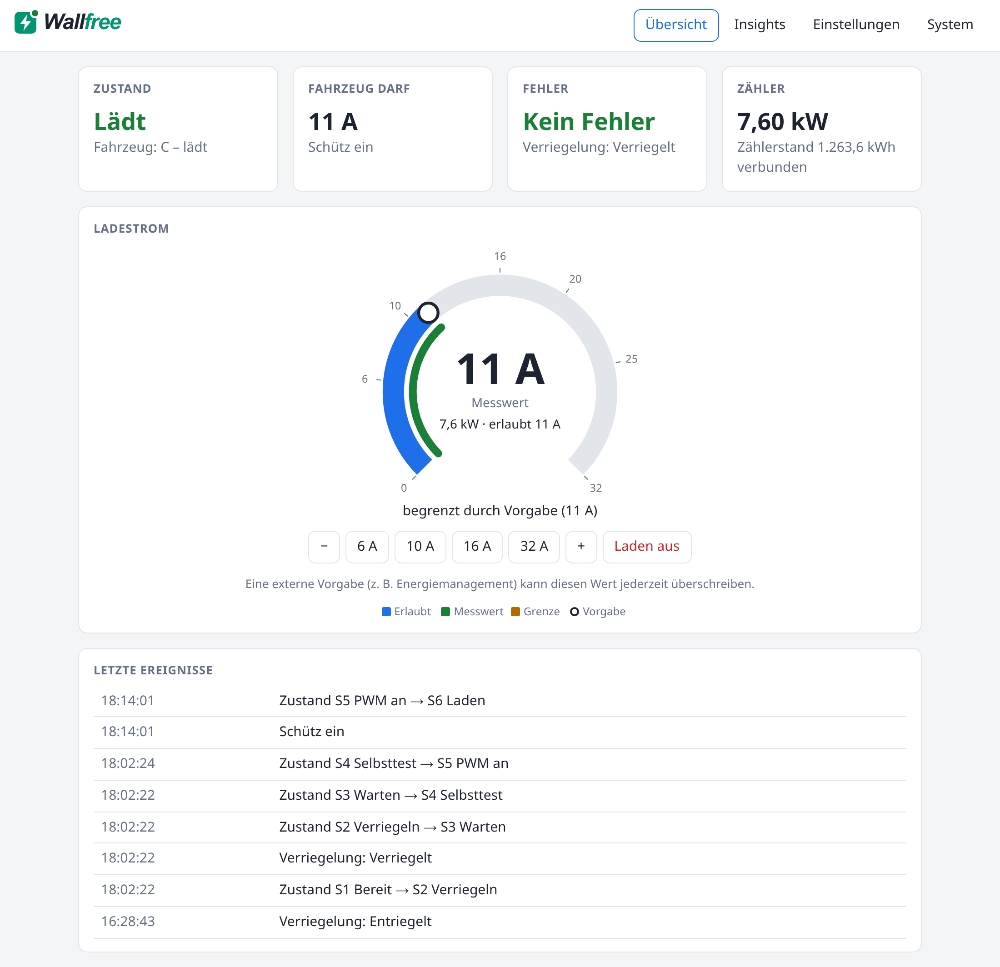

Die **Kopfzeile** enthält:

- **Wallfree**: Ein Klick führt zur Übersicht. Der **Punkt am Logo** zeigt die Verbindung:
  - grün: Die Seite erhält laufend Daten von der Steuerung (Text beim Zeigen mit der Maus).
  - rot: Seit 5 Sekunden kommen keine Daten. Unter der Kopfzeile erscheint die rote Leiste
    „Verbindung zur Wallbox getrennt – angezeigte Werte sind nicht aktuell“; der Inhalt wird
    grau und lässt sich nicht bedienen, bis die Verbindung wieder steht. Die Seite verbindet
    sich selbständig neu.
  - orange mit der Leiste „Update läuft“: während eines Firmware-Updates (Abschnitt 8.1).

  Ein Tab im Hintergrund fragt die Steuerung nicht ab und belegt keine ihrer wenigen
  Verbindungen; beim Zurückholen lädt die Seite sofort neu.
- die **Bereiche** Übersicht, Status, Einstellungen und System.

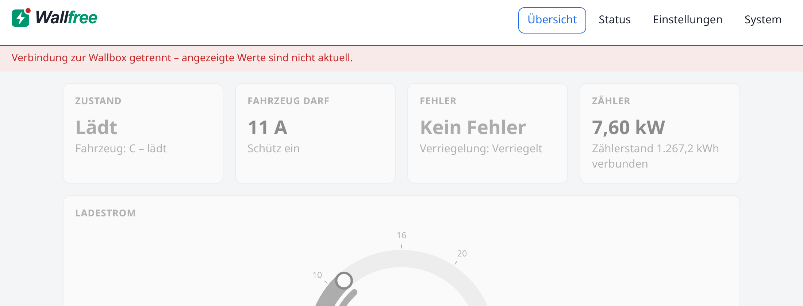

Der gewählte Bereich steht in der Adresszeile (z. B. `…/#/einstellungen/mqtt`). Die
Zurück-Taste des Browsers und Lesezeichen funktionieren damit wie gewohnt.

Auf dem Smartphone stehen die Bereiche unter dem Titel, die Kacheln untereinander.

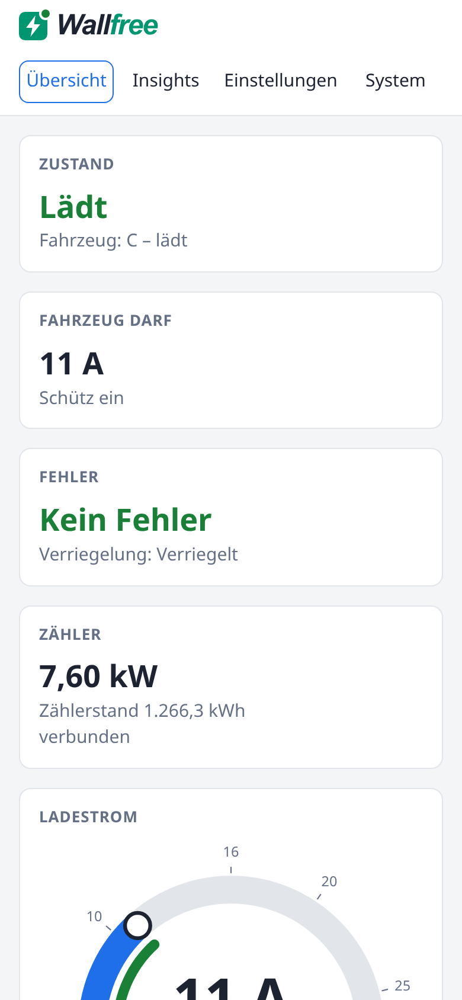

**Einfache Ansicht und Expertenansicht:** Ab Werk zeigt die Oberfläche nur, was man im Alltag
braucht. Die **Expertenansicht** (Bereich System, Abschnitt 8) zeigt zusätzlich die Parameter
der Ladelogik (Einstellungen → Laden) und die Rohwerte unter Status (Ladestrom, Zähler, Ladelogik,
CP-Oszilloskop). Die Wahl gilt nur für den jeweiligen Browser; an der Steuerung
ändert sie nichts.

**Uhrzeiten:** Hat die Steuerung noch keine Uhrzeit, berechnet der Browser alle Uhrzeiten aus
der Laufzeit der Steuerung und seiner eigenen Uhr. Sie sind dann auf wenige Sekunden genau.

## 5 Übersicht

Die Übersicht zeigt den aktuellen Zustand auf einen Blick und erlaubt, den Ladestrom
vorzugeben.

### 5.1 Kacheln

| Kachel | Inhalt |
| --- | --- |
| **Zustand** | Zustand der Ladestation: *Kein Fahrzeug*, *Wartet auf Freigabe*, *Bereit*, *Lädt* oder *Fehler*. Darunter der Zustand des Fahrzeugs nach IEC 61851 (A kein Fahrzeug, B verbunden, C lädt, D lädt mit Lüftungsanforderung, E/F Fehler). |
| **Fahrzeug darf** | Strom, den das Fahrzeug im Moment ziehen darf (vom Ladesignal an das Fahrzeug gemeldet), und ob das Schütz (der Leistungsschalter der Ladestation) ein- oder ausgeschaltet ist. |
| **Fehler** | *Kein Fehler* oder die Art des Fehlers; darunter der Zustand der Verriegelung des Ladesteckers. Einzelheiten zu Fehlern stehen unter Status. |
| **Zähler** | Nur mit eingerichtetem Energiezähler: aktuelle Ladeleistung in kW, Zählerstand in kWh und Zustand der Verbindung zum Zähler. Ohne Zähler bleibt die Kachel leer. |

### 5.2 Ladestrom

Die Ringanzeige stellt alle Größen dar, die den Ladestrom bestimmen. Der Ring reicht von 0
bis zum **Maximum**, das am Drehschalter der Steuerung eingestellt ist.

| Element | Bedeutung |
| --- | --- |
| blauer Ring **Erlaubt** | Strom, den das Fahrzeug ziehen darf |
| grüner Innenring **Messwert** | gemessener Strom (höchste Phase), nur mit Energiezähler |
| orange Marke **Grenze** | eine weitere Grenze unterhalb des Maximums: Belastbarkeit des Ladekabels oder Stromgrenze über einen Digitaleingang |
| Kreis **Vorgabe** | der vorgegebene Ladestrom; rot bei „Laden aus“ |
| Zahl in der Mitte | Messwert, ohne Zähler der erlaubte Strom; darunter die Leistung |
| Zeile unter dem Ring | was den Strom gerade begrenzt, z. B. „begrenzt durch Kabel (20 A)“ oder „Vorgabe: Laden aus“ |

Der erlaubte Strom ist immer der **kleinste** der Werte Vorgabe, Maximum, Kabel und
Digitaleingang. Unter 6 A wird nicht geladen (Grenze der Norm).

**Vorgabe ändern:** Die Tasten unter dem Ring wirken sofort.

| Taste | Wirkung |
| --- | --- |
| **−** / **+** | Vorgabe in Schritten von 1 A zwischen 6 A und dem Maximum |
| **6 / 10 / 16 / 32 A** | Vorgabe auf diesen Wert (Tasten über dem Maximum entfallen) |
| **Laden aus** | Vorgabe 0: Ein laufender Ladevorgang endet geordnet, ein neuer beginnt nicht |

Die Vorgabe gilt bis zur nächsten Änderung oder bis zum Neustart der Steuerung; danach gilt
der Startwert (Parameter `external_current_default`, [7.1](#71-laden)). Ein angeschlossenes
Energiemanagement (z. B. evcc) setzt die Vorgabe selbst und überschreibt Änderungen von Hand.

### 5.3 Letzte Ereignisse

Die letzten 8 Ereignisse mit Uhrzeit: Zustandswechsel, Schützschaltungen, Verriegelung,
Fehler und Änderungen des Zählerzustands. Das vollständige Protokoll steht unter Status.

## 6 Status

Status zeigt Verlauf, Verbindungen, Messwerte und Protokolle, z. B. um einen Ladevorgang
nachzuvollziehen oder eine Störung einzugrenzen. In der einfachen Ansicht stehen hier nur
Verlauf, Verbindungen, Fehler und Ereignisprotokoll; die Abschnitte 6.5 bis 6.8 gibt es nur in
der Expertenansicht.

### 6.1 Verlauf

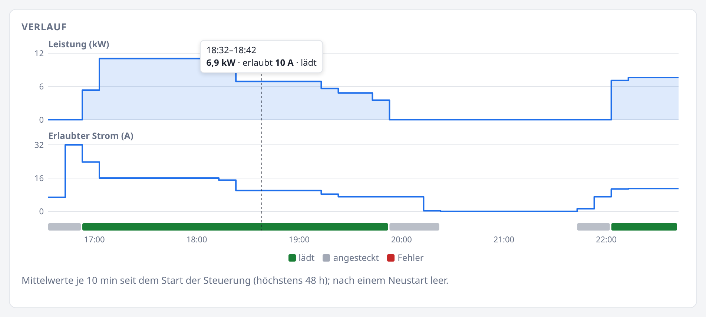

Der Verlauf zeigt Mittelwerte über jeweils **10 Minuten** seit dem Start der Steuerung,
höchstens die letzten **48 Stunden**:

- **Leistung (kW)**: mittlere Ladeleistung, nur mit Energiezähler.
- **Erlaubter Strom (A)**: mittlerer Strom, den das Fahrzeug ziehen durfte.
- **Zustandsband** darunter: grün *lädt*, grau *angesteckt*, rot *Fehler*.

Beim Zeigen mit der Maus oder Tippen auf die Kurve erscheinen Zeitraum und Werte des
Intervalls. Der Verlauf wird nur im Arbeitsspeicher gehalten und ist nach einem Neustart
oder Stromausfall leer.

### 6.2 Verbindungen

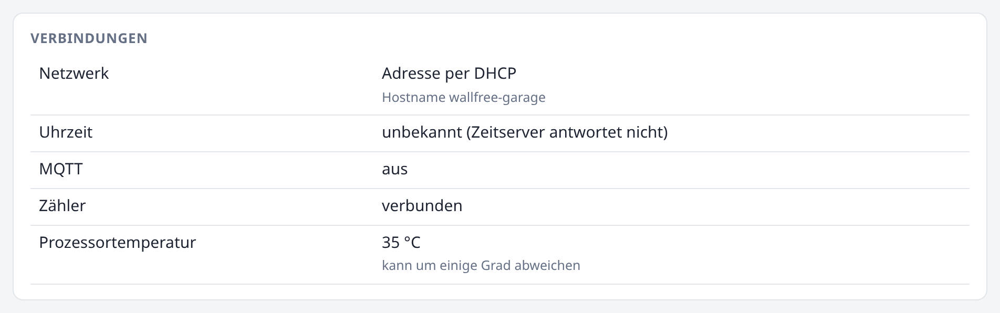

Zustand der Verbindungen der Steuerung; eingestellt werden sie unter Einstellungen
([7.2](#72-netzwerk) bis [7.4](#74-zähler)).

| Zeile | Inhalt |
| --- | --- |
| Netzwerk | Adresse per DHCP oder die feste Adresse, darunter der Hostname |
| Uhrzeit | Uhrzeit der Steuerung, darunter der Zeitserver und wann zuletzt abgeglichen; „unbekannt“, solange kein Zeitserver antwortet. Ein Neustart behält die Uhrzeit („aus der internen Uhr, noch nicht abgeglichen“), bis der Zeitserver antwortet; nach einem Stromausfall ist sie unbekannt (keine Pufferbatterie). |
| MQTT | aus, nicht verbunden, verbunden oder vom Broker abgelehnt; verbunden mit Broker, Präfix und der Zahl gesendeter Nachrichten und empfangener Befehle |
| Zähler | kein Zähler, verbinde …, verbunden oder gestört |
| Prozessortemperatur | Temperatur im Prozessor der Ladesteuerung in °C. Ohne Abgleich kann sie um einige Grad abweichen; abgleichen lässt sie sich in der Expertenansicht unter System. |

### 6.3 Fehler

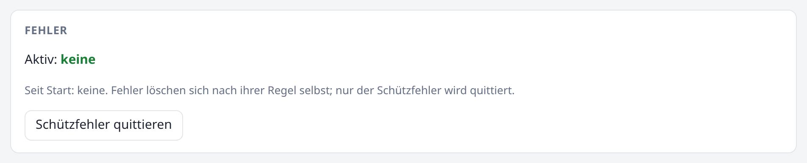

- **Aktiv:** Fehler, die im Moment bestehen.
- **Seit Start:** alle Fehler, die seit dem letzten Start aufgetreten sind.
- **Tabelle:** zeitliche Abfolge der Fehler mit Zustand der Ladestation.

Fehler heben sich nach ihrer Regel selbst auf, meist sobald die Ursache entfällt oder das
Fahrzeug abgesteckt wird. Ausnahme ist der **Schützfehler** (das Schütz schaltet nicht wie
befohlen): Er bleibt bestehen, bis er mit **Schützfehler quittieren** bestätigt oder die
Steuerung neu gestartet wird. Quittieren Sie ihn erst, wenn die Ursache geprüft und behoben
ist. Fehler erscheinen hier mit ihrer Kennung (z. B. `CP-INVALID`); die Bedeutung steht in
[10.5](#105-fehler).

### 6.4 Ereignisprotokoll

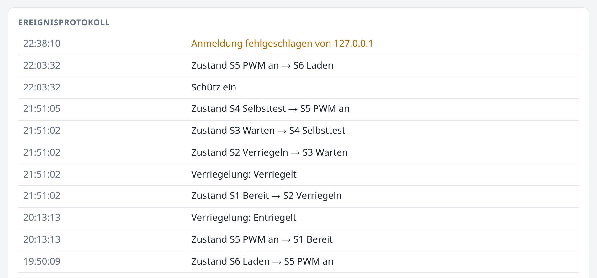

Die letzten 48 Einträge, auch über Neustarts hinweg: jeder **Start** mit seinem Grund (z. B.
„Start: Überwachung (Ladelogik reagierte nicht)“), alle Ereignisse und **fehlgeschlagene Anmeldungen**
mit der Adresse des Geräts (orange). Mehrere Fehlversuche desselben Geräts werden zu einem
Eintrag mit Anzahl zusammengefasst. Unbekannte Fehlversuche können auf einen Zugriffsversuch
im Netz oder auf ein Gerät mit veralteten Zugangsdaten hinweisen.

Das Ereignisprotokoll übersteht Neustarts, Updates und Werksreset, aber keinen Stromausfall. Einträge
aus einem früheren Start zeigen „unbekannte Zeit“, wenn die Steuerung in diesem Start keine
Uhrzeit von einem Zeitserver hatte. Mit Zeitserver erhalten auch die Einträge aus den ersten
Sekunden nach dem Start (vor dem Zeitabgleich) nachträglich ihre Uhrzeit.

**Protokoll löschen** entfernt nach einer Rückfrage alle Einträge. Das Löschen selbst bleibt als
erster Eintrag „Ereignisprotokoll gelöscht von …“ mit der Adresse des Geräts stehen.

### 6.5 Ladestrom

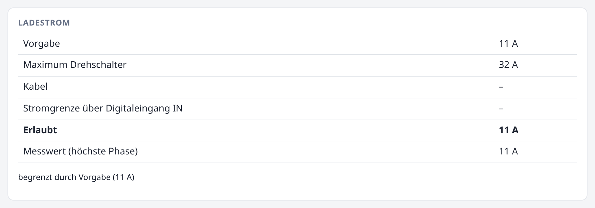

Dieselben Größen wie die Ringanzeige als Zahlen:

| Zeile | Bedeutung |
| --- | --- |
| Vorgabe | vorgegebener Ladestrom (von Hand, Energiemanagement oder MQTT) |
| Maximum Drehschalter | am Drehschalter eingestellt bzw. abgesenkt ([7.1](#71-laden), `hardware_limit_override`) |
| Kabel | Belastbarkeit des Ladekabels, nur bei Ladestationen mit Steckdose |
| Stromgrenze über Digitaleingang | Grenze durch einen aktiven Digitaleingang; genannt werden die Eingänge mit einer Stromgrenze als Funktion ([10.2](#102-eingangsfunktionen)) |
| **Erlaubt** | Ergebnis: Strom, den das Fahrzeug ziehen darf |
| Messwert | gemessener Strom der höchsten Phase (nur mit Zähler) |

Die gerade wirkende Grenze ist orange mit „begrenzt“ markiert.

### 6.6 CP-Oszilloskop

Die Karte **CP-Oszilloskop** (unter „Ladestrom“) zeigt auf Knopfdruck (**Aufnehmen**) den Verlauf
der Signalleitung zum Fahrzeug über eine PWM-Periode (1 ms), mit den Spannungen der
Fahrzeugzustände A (12 V, kein Fahrzeug), B (9 V, angeschlossen), C (6 V, lädt), D (3 V, lädt
mit Lüftung) und −12 V. Daneben steht der Tastgrad, aus dem das Fahrzeug den erlaubten Strom
abliest. So lässt sich bei einem Fahrzeug, das nicht lädt, sehen, ob es den Zustand richtig
meldet und ob der negative Teil (−12 V) sauber anliegt.

Die Aufnahme dauert etwa eine Zehntelsekunde und stört das Laden nicht. Sie setzt sich aus
etwa 110 Perioden zusammen; ändert sich der Zustand während der Aufnahme, ist das Bild
verwischt, dann einfach erneut aufnehmen.

### 6.7 Zähler

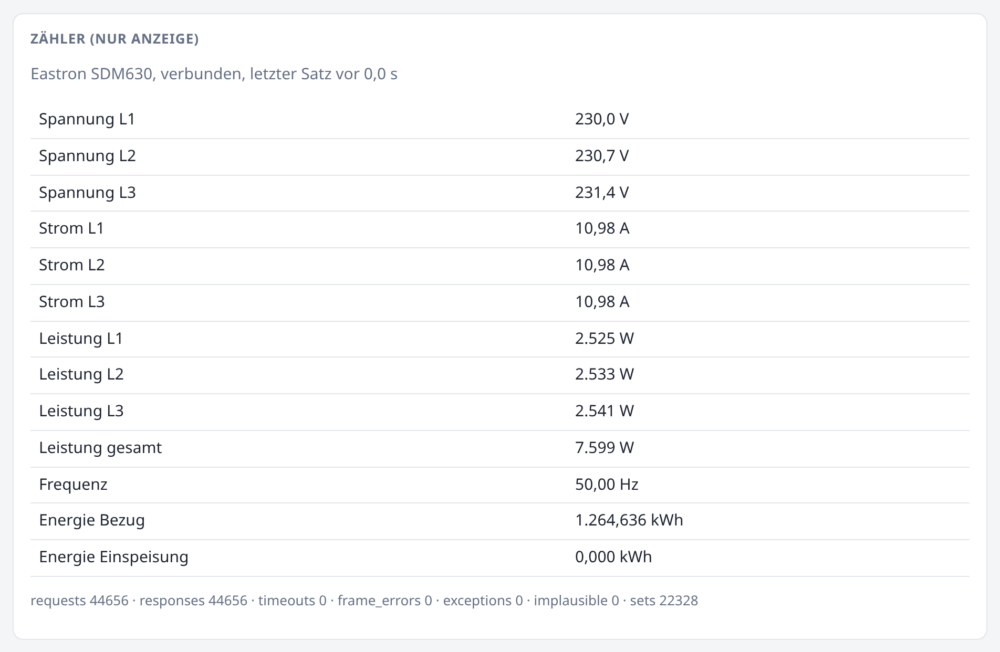

Nur mit eingerichtetem Energiezähler: Typ und Zustand des Zählers, Alter des letzten
Messwertsatzes, alle Messwerte (Spannungen, Ströme, Leistungen, Frequenz, Energie) und die
Zähler der Abfragen (Anfragen, Antworten, Zeitüberschreitungen, gestörte Antworten,
Ausnahmen, unplausible Werte). Steigen Zeitüberschreitungen oder gestörte Antworten
laufend, prüfen Sie Verdrahtung, Adresse und Übertragungsparameter ([7.4](#74-zähler)).
„ungültig“ bedeutet: Der Wert fehlt oder ist veraltet. Er wird bewusst nicht als 0
angezeigt.

### 6.8 Ladelogik

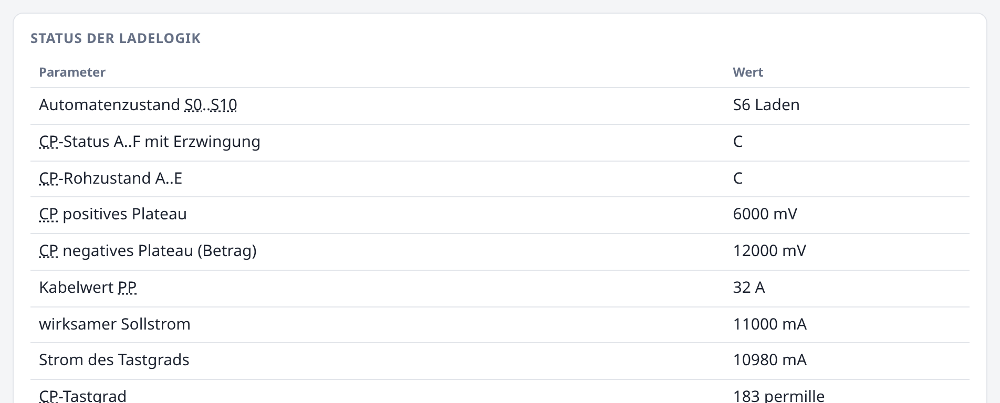

Innere Zustände der Ladesteuerung, vor allem für die Fehlersuche. Die Werte sind nur lesbar.

| Wert | Bedeutung |
| --- | --- |
| Automatenzustand S0..S10 | Ablaufschritt: S0 Start, S1 Bereit (kein Fahrzeug), S2 Verriegeln, S3 Warten (auf Freigabe, Strom ≥ 6 A, Verfügbarkeit), S4 Selbsttest der Fehlerstromüberwachung, S5 Ladesignal an (wartet auf das Fahrzeug), S6 Laden, S7 Beenden, S8 Entriegeln, S9 Fehler, S10 Nicht verfügbar |
| CP-Status A..F mit Erzwingung | Zustand der Ladeleitung (Control Pilot) nach IEC 61851, wie er nach außen gemeldet wird (E/F auch bei Fehlern) |
| CP-Rohzustand A..E | gemessener Zustand der Ladeleitung ohne Fehlerbehandlung |
| CP positives / negatives Plateau | gemessene Spannungen des Ladesignals in mV |
| Kabelwert PP | Belastbarkeit des gesteckten Kabels (13, 20, 32, 63 A), 0 = kein gültiger Wert |
| wirksamer Sollstrom | kleinster der Stromwerte (Vorgabe, Maximum, Kabel, Digitaleingang) in mA |
| Strom des Tastgrads | Strom, den das Ladesignal dem Fahrzeug meldet, in mA |
| CP-Tastgrad | Tastgrad des Ladesignals in Promille (1000 = kein Ladesignal) |
| Stromsperre | 1 = Laden gesperrt (Vorgabe 0, Pause oder Strom unter 6 A) |
| 5-%-Modus aktiv | 1 = Ladesignal 5 % (für digitale Kommunikation, Laden darüber nicht im Umfang) |
| keine Digitalkommunikation | 1 = 5-%-Modus und Fahrzeug will laden |
| aktive Fehler / seit Start aufgetretene Fehler | Fehler als Text ([10.5](#105-fehler)) |
| Warnungen | 1 = Versorgungsspannung zu niedrig (nur Hinweis, keine Abschaltung) |
| Schütz Soll (Klemme C1/C2) | 1 = Schütz soll eingeschaltet sein (Ansteuerung der Spule an C1/C2) |
| Spannung an Klemme CT (Schütz Ist) | 1 = an CT liegt Netzspannung an. Bei der wallbe hängt CT an L1 hinter dem Schütz: Soll und Ist sollten übereinstimmen; „Soll 0, Spannung 1“ deutet auf einen verklebten Kontakt (L1). Wird angezeigt, auch wenn die Schützüberwachung aus ist |
| Ladedauer des Steckvorgangs | bisherige Ladezeit (Schütz ein) im aktuellen Steckvorgang in ms |
| Ladeerlaubnis / Freigabe / Verfügbarkeit fehlt | Freigabelogik ([10.4](#104-freigabe-und-verfügbarkeit)) |
| Drehschalterstellung | Stellung 0..15 beim Start |
| DIP-Schalter an | eingeschaltete DIP-Schalter, z. B. „D1, D2, D4“ (wirksame Stellung, auch wenn sie über `dip_override` überschrieben ist; [10.1](#101-dip-schalter-und-drehschalter)) |
| RCM-Selbsttest 0..4 | Selbsttest der Fehlerstromüberwachung: 0 nicht gelaufen, 1 läuft, 2 bestanden, 3 fehlgeschlagen, 4 abgebrochen (klingt ab) |
| Eingang LD … IN, Ausgang ER … CR | Schaltzustand jedes Digitaleingangs und -ausgangs: an oder aus |
| Fehlversuche Verriegeln / Entriegeln | Anzahl fehlgeschlagener Versuche im aktuellen Steckvorgang |

## 7 Einstellungen

Die Einstellungen sind in die Reiter **Laden**, **Netzwerk**, **MQTT**, **Zähler** und
**Anmeldedaten** gegliedert. Den Reiter Laden gibt es nur in der Expertenansicht.

#### Allgemein

- Fährt man mit der Maus über eine Bezeichnung, erscheint der interne Name des Parameters
  (wie in dieser Anleitung in `Schreibmaschinenschrift`).
- Ungültige Werte werden mit einer Meldung abgelehnt und nicht übernommen.
- Einstellungen in den Reitern Netzwerk und Zähler wirken erst nach einem **Neustart**. Die
  Seite weist darauf hin und bietet **Jetzt neu starten** an. MQTT-Einstellungen wirken
  sofort.

### 7.1 Laden

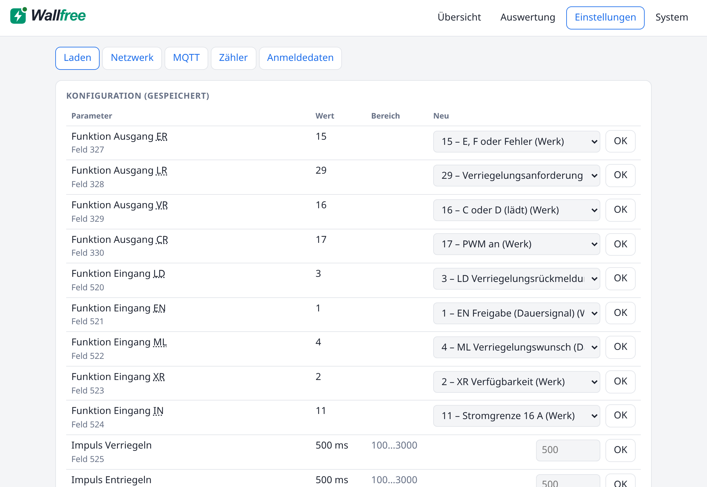

Der Reiter zeigt zwei Tabellen: **Konfiguration** (dauerhaft gespeichert) und
**Laufzeitwerte** (gelten bis zum Neustart). Spalten: Bezeichnung, aktueller Wert, erlaubter
Bereich und ein Feld für den neuen Wert mit **OK** (oder Eingabetaste). Im leeren Feld steht
grau die Werkseinstellung. Funktionen der Ein- und Ausgänge, Schützüberwachung und Weckfolge
werden aus einer Liste gewählt (Code und Bezeichnung, die Werkseinstellung ist mit „Werk“
markiert; die Spalte Wert zeigt dort nur den Code), Ja/Nein-Werte mit einem Kästchen; übernommen wird jeweils erst mit **OK**.
„Feld …“ unter der Bezeichnung nennt die Nummer des entsprechenden Parameters der
Herstellerfirmware, zur Übertragung bestehender Einstellungen.

Abkürzungen wie LD, CP oder D8 sind gepunktet unterstrichen: Zeigt man mit der Maus darauf,
erscheint eine kurze Erklärung. Dieselben Erklärungen stehen aufklappbar unter **Begriffe** am
Ende der Seite.

#### Konfiguration (dauerhaft gespeichert)

##### Ausgänge und Eingänge

| Parameter | Bereich | Werk | Beschreibung |
| --- | --- | --- | --- |
| Funktion Ausgang ER (`out_function_er`) | 0..42 | 15 | Legt fest, wann der Digitalausgang ER schaltet. Werkseitig: bei Fehler (Code 15). Codes in [10.3](#103-ausgangsfunktionen). |
| Funktion Ausgang LR (`out_function_lr`) | 0..42 | 29 | Wie oben für Ausgang LR. Werkseitig: Verriegelung angefordert (Code 29). |
| Funktion Ausgang VR (`out_function_vr`) | 0..42 | 16 | Wie oben für Ausgang VR. Werkseitig: Fahrzeug lädt (Code 16). |
| Funktion Ausgang CR (`out_function_cr`) | 0..42 | 17 | Wie oben für Ausgang CR. Werkseitig: Ladesignal an (Code 17). |
| Funktion Eingang LD (`in_function_ld`) | 0..22 | 3 | Legt fest, was ein Signal am Digitaleingang LD bewirkt. Werkseitig: Rückmeldung der Steckerverriegelung (Code 3). Codes in [10.2](#102-eingangsfunktionen). |
| Funktion Eingang EN (`in_function_en`) | 0..22 | 1 | Wie oben für Eingang EN. Werkseitig: Freigabe, solange der Eingang eingeschaltet ist (Code 1), z. B. für einen Schlüsselschalter. |
| Funktion Eingang ML (`in_function_ml`) | 0..22 | 4 | Wie oben für Eingang ML. Werkseitig: manuelle Verriegelung (Code 4). |
| Funktion Eingang XR (`in_function_xr`) | 0..22 | 2 | Wie oben für Eingang XR. Werkseitig: Verfügbarkeit (Code 2), z. B. für ein Sperrsignal des Netzbetreibers. |
| Funktion Eingang IN (`in_function_in`) | 0..22 | 11 | Wie oben für Eingang IN. Werkseitig: Stromgrenze 16 A, solange der Eingang eingeschaltet ist (Code 11). |

Die Eingänge EN, XR und LD wirken nur, wenn der zugehörige DIP-Schalter an ist (D7, D8, D6;
[10.1](#101-dip-schalter-und-drehschalter)). Ein Eingang mit Code 0 hat keine Wirkung.

##### Verriegelung des Ladesteckers

Nur bei Ladestationen mit Steckdose und Verriegelung (DIP D4).

| Parameter | Bereich | Werk | Beschreibung |
| --- | --- | --- | --- |
| Impuls Verriegeln (`lock_pulse`) | 100..3000 ms | 500 | Wie lange der Motor der Steckerverriegelung zum Verriegeln angesteuert wird. Nach den Angaben des Herstellers des Verriegelungsaktors einstellen; zu kurz verriegelt nicht sicher, zu lang belastet den Motor. |
| Impuls Entriegeln (`unlock_pulse`) | 100..3000 ms | 500 | Wie oben für das Entriegeln. |
| Mindestabstand der Verriegelungszyklen (`lock_cycle_gap`) | 500..10000 ms | 2000 | Pause zwischen zwei Ver- oder Entriegelungsvorgängen. Schützt den Motor bei wiederholten Versuchen (bis zu 5 Versuche beim Verriegeln, 4 beim Entriegeln). |
| LD gepulst auch beim Entriegeln prüfen (`unlock_check`) | 0..1 | 0 | Nur bei Rückmeldung „LD gepulst“ (Eingangscode 22): 1 = auch beim Entriegeln prüfen, ob sich der Motor bewegt hat; 0 = Entriegeln gilt nach dem Impuls als erfolgt. Nur einschalten, wenn der Aktor dabei eine Rückmeldung liefert. |

##### Schütz und Überwachung

| Parameter | Bereich | Werk | Beschreibung |
| --- | --- | --- | --- |
| Mindestpause vor erneutem Schütz-Ein (`contactor_min_off`) | 0..10000 ms | 5000 | Kürzeste Zeit, die das Schütz nach dem Ausschalten aus bleibt, bevor es wieder einschalten darf. Schont das Schütz bei schnell wechselnden Anforderungen des Fahrzeugs; manche Schütze ziehen nach einer kürzeren Pause nicht wieder an. |
| Schützüberwachung (`contactor_monitor`) | 0..4 | 1 | Wie geprüft wird, ob das Schütz nach dem Ausschalten wirklich offen ist (z. B. verschweißte Kontakte): 0 aus, 1 über die Spannungsmessung am Ladepunkt (Klemme CT), 2 über einen Rückmeldekontakt als Schließer (Eingangscode 5), 3 als Öffner (Eingangscode 6), 4 über den Energiezähler (Spannung je Phase über 50 V). 4 nur mit eingerichtetem Zähler. Erkennt die Überwachung einen Fehler, wird nicht mehr geladen, bis der Schützfehler quittiert ist ([6.3](#63-fehler)). |
| Zustand D abweisen (`reject_state_d`) | 0..1 | 1 | Fahrzeuge, die beim Laden eine Lüftung anfordern (Zustand D, z. B. ältere Fahrzeuge mit Bleiakku), werden mit 1 abgewiesen. Nur auf 0 setzen, wenn der Ladeplatz ausreichend belüftet ist. |
| Überstromabschaltung (`overcurrent_enable`) | 0..1 | 0 | 1 = Laden abbrechen, wenn das Fahrzeug deutlich mehr Strom zieht als erlaubt (mehr als das 1,25-Fache für 5 s oder das 1,1-Fache für 95 s). Nur mit eingerichtetem Energiezähler einschaltbar. Fällt der Zähler dann aus, endet das Laden. |

##### Weckfolge für Fahrzeuge

Manche Fahrzeuge reagieren nach längerem Stillstand nicht auf das Ladesignal. Die Weckfolge
schaltet das Ladesignal kurz ab und wieder an, um das Fahrzeug zum Laden zu bewegen.

| Parameter | Bereich | Werk | Beschreibung |
| --- | --- | --- | --- |
| Wartezeit bis zur Weckfolge (`wakeup_delay`) | 0 oder 5000..300000 ms | 30000 | Wie lange gewartet wird, wenn das Fahrzeug verbunden ist, aber trotz Ladesignal nicht lädt, bevor die Weckfolge läuft. 0 schaltet die Weckfolge ab. |
| Weckfolge (`wakeup_mode`) | 0..1 | 0 | 0 = höchstens einmal je Steckvorgang; 1 = zusätzlich nach jeder Ladepause durch die Ladestation (z. B. wenn ein Energiemanagement das Laden unterbrochen hat). |

##### Startwerte nach einem Neustart

| Parameter | Bereich | Werk | Beschreibung |
| --- | --- | --- | --- |
| Startwert des Sollstroms (`external_current_default`) | 0 oder 6000..80000 mA | 80000 | Vorgabe, die nach jedem Start gilt, bis jemand (von Hand oder per Energiemanagement) eine andere setzt. 80000 = keine Einschränkung, die Station lädt mit dem Maximum. 0 = nach einem Start erst laden, wenn eine Vorgabe kommt; sinnvoll, wenn ein Energiemanagement das Laden immer steuern soll. Mit DIP D10 gilt nach jedem Start 0, weil dort eine Vorgabe über 0 das Laden freigibt ([10.4](#104-freigabe-und-verfügbarkeit)). |
| Startwert der Freigabe über Schnittstelle (`enable_register_default`) | 0..1 | 0 | Startwert für den Laufzeitwert „Freigabe über Schnittstelle“. Nur mit DIP D10 von Bedeutung ([10.4](#104-freigabe-und-verfügbarkeit)): 1 = nach einem Start ist das Laden freigegeben. |

#### Laufzeitwerte (gelten bis zum Neustart)

Diese Werte steuern den laufenden Betrieb. Nach einem Neustart gelten wieder ihre Startwerte.

| Parameter | Bereich | Start | Beschreibung |
| --- | --- | --- | --- |
| Sollstrom der Schnittstelle (`external_current`) | 0 oder 6000..80000 mA | Startwert | Die Vorgabe des Ladestroms, dieselbe wie bei den Tasten der Übersicht und dem Energiemanagement. 0 = Laden aus. Werte über dem Maximum sind erlaubt, wirksam bleibt das Maximum. |
| Freigabe über Schnittstelle (`enable_register`) | 0..1 | Startwert | Nur mit DIP D10: 1 = Laden freigegeben. |
| Verfügbarkeit über Schnittstelle (`available_register`) | 0..1 | 1 | Nur mit DIP D10: 0 = Ladestation außer Betrieb (dem Fahrzeug wird „nicht verfügbar“ gemeldet). |
| 5-%-Modus (`pwm5_request`) | 0..1 | 0 | 1 = Ladesignal mit 5 % (Anforderung digitaler Kommunikation nach ISO 15118). Diese Kommunikation unterstützt die Firmware nicht; es wird dann nicht geladen. Für Prüfzwecke. |
| Laden unterbrechen (`pause_request`) | 0..1 | 0 | 1 = Ladepause: ein laufendes Laden endet geordnet, die Verriegelung bleibt bestehen. 0 = weiter. |
| Verriegelungswunsch (`lock_request`) | 0..1 | 0 | Nur mit DIP D9 (manuelle Verriegelung): 1 = Stecker verriegeln (auch ohne Fahrzeug), 0 = Laden beenden und entriegeln. Wirkt wie der Eingang ML; das jüngste Ereignis gilt. |
| Entriegeln-Anforderung (`unlock_request`) | 0..1 | 0 | 1 = Laden beenden, Stecker entriegeln und bis zum Abstecken nicht wieder verriegeln (z. B. um ein Kabel freizugeben). Wird beim Abstecken zurückgesetzt. |
| Register-Ausgang 1..4 (`register_output_1` … `_4`) | 0..1 | 0 | Frei schaltbare Zustände für die Digitalausgänge: Ein Ausgang mit Code 30..33 folgt dem Register-Ausgang 1..4. So lassen sich Ausgänge über die Schnittstelle schalten. |
| Obergrenze absenken (`hardware_limit_override`) | 0 oder 6000 mA..Maximum | 0 | Senkt das Maximum des Drehschalters vorübergehend ab, z. B. bei einem Hausanschluss mit begrenzter Leistung. 0 = Maximum des Drehschalters. Anheben über den Drehschalter hinaus ist nicht möglich. |
| DIP D1..D10 (`dip_override`) | 0..1023 | Schalterstellung | Überschreibt die DIP-Schalter bis zum nächsten Neustart, als Zahl aus Bits (Bit 0 = D1 … Bit 9 = D10, siehe [10.1](#101-dip-schalter-und-drehschalter)). Nur ohne Fahrzeug. Für Prüfzwecke; dauerhaft gelten die Schalter am Gerät. |
| Verriegelung (`lock_state`) | Anzeige 0..5, Schreiben 0/1 | gespeichert | Zeigt den Zustand der Steckerverriegelung (0 Start, 1 entriegelt, 2 verriegelt gerade, 3 verriegelt, 4 entriegelt gerade, 5 Fehler). Schreiben von 1 verriegelt, 0 entriegelt; nur ohne Fahrzeug. |

### 7.2 Netzwerk

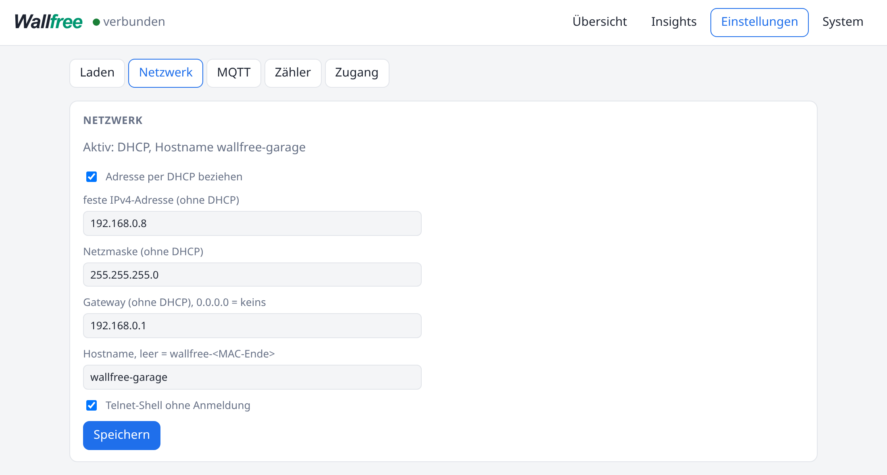

Änderungen an der Adresse wirken nach einem Neustart, die Zeitserver-Einstellungen sofort. Die
aktive Einstellung und die Uhrzeit zeigt [Status › Verbindungen](#62-verbindungen).

| Parameter | Werk | Beschreibung |
| --- | --- | --- |
| Adresse per DHCP beziehen (`net_dhcp`) | an | an = die Steuerung erhält ihre Adresse vom Router. Aus = es gelten die drei folgenden Werte. |
| feste IPv4-Adresse (`net_ip`) | 192.168.0.8 | Adresse der Steuerung ohne DHCP. Muss im Netz des Routers liegen und darf nicht doppelt vergeben sein. |
| Netzmaske (`net_netmask`) | 255.255.255.0 | Netzmaske ohne DHCP, im Heimnetz meist 255.255.255.0. |
| Gateway (`net_gateway`) | 192.168.0.1 | Adresse des Routers ohne DHCP; 0.0.0.0 = keiner (dann ist die Steuerung nur im eigenen Netz erreichbar). |
| Hostname (`net_hostname`) | leer | Name der Steuerung im Netz (1..32 Zeichen: Buchstaben, Ziffern, Bindestrich). Leer = `wallfree-` und das Ende der Hardwareadresse. Der Name dient auch als Kennung am MQTT-Broker. |
| Uhrzeit von einem Zeitserver holen (`ntp_enable`) | an | Die Steuerung holt die Uhrzeit per SNTP; damit zeigen Protokoll und Verlauf echte Uhrzeiten, auch für Einträge vor einem Neustart. Wirkt sofort. Für das Laden wird die Uhrzeit nie gebraucht. |
| Zeitserver (`ntp_server`) | leer | Name oder Adresse eines Zeitservers, z. B. `fritz.box` oder `ptbtime1.ptb.de`, optional mit `:Port`. Leer: der Zeitserver, den der Router mitteilt, sonst `pool.ntp.org`. Wirkt sofort. |

> **Achtung:** Eine falsche feste Adresse macht die Steuerung unerreichbar. Prüfen Sie die
> Werte vor dem Neustart. Ist die gespeicherte Adresse in sich widersprüchlich, startet die
> Steuerung mit DHCP. Notfalls hilft der Werksreset ([Abschnitt 9](#9-störungen-und-abhilfe)).

### 7.3 MQTT

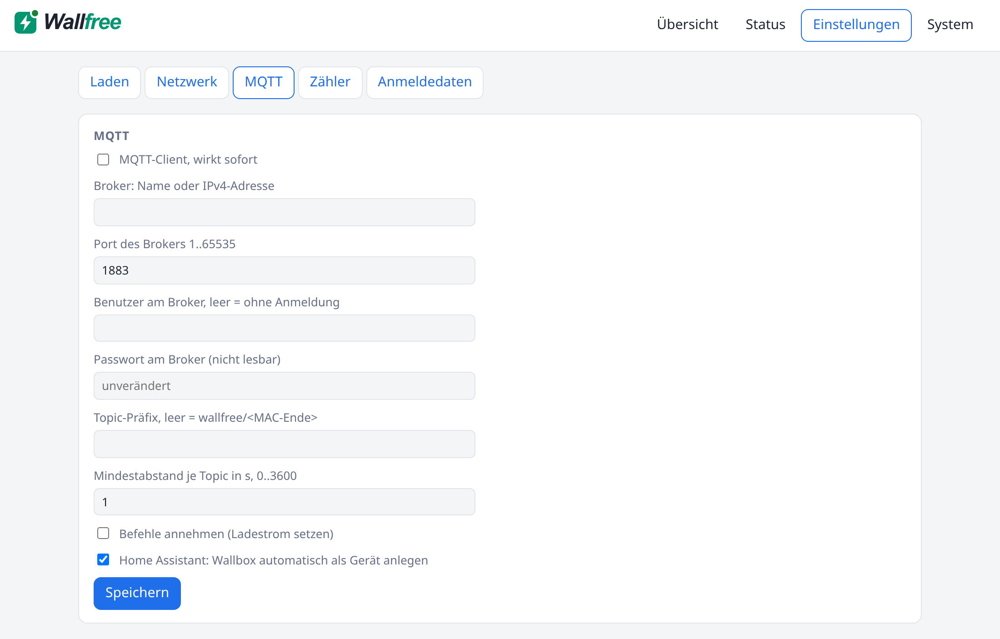

Über MQTT meldet die Steuerung ihre Zustände an einen Broker (z. B. für eine
Hausautomation). Den Zustand der Verbindung zeigt [Status › Verbindungen](#62-verbindungen).
Änderungen wirken **sofort**; die Verbindung wird mit den neuen Werten neu aufgebaut.
Ein fehlender Broker beeinträchtigt das Laden nicht.

| Parameter | Werk | Beschreibung |
| --- | --- | --- |
| MQTT-Client (`mqtt_enable`) | aus | Schaltet die Verbindung zum Broker ein. Einschaltbar erst mit eingetragener Broker-Adresse. |
| Broker (`mqtt_broker`) | leer | Name oder Adresse des Brokers, z. B. `homeassistant.local` oder `192.168.178.10`, ohne Port (der steht im nächsten Feld). Ein Name wird bei jedem Verbindungsaufbau neu aufgelöst. |
| Port des Brokers (`mqtt_port`) | 1883 | TCP-Port des Brokers. Verschlüsselte Verbindungen (TLS, meist 8883) werden nicht unterstützt. |
| Benutzer am Broker (`mqtt_user`) | leer | Benutzername am Broker; leer = ohne Anmeldung. |
| Passwort am Broker (`mqtt_password`) | leer | Passwort am Broker. Es wird nie angezeigt („unverändert“); ein leeres Feld lässt das gespeicherte Passwort unverändert. |
| Topic-Präfix (`mqtt_prefix`) | leer | Anfang aller Topics; leer = `wallfree/` und das Ende der Hardwareadresse. Zustände erscheinen unter `<Präfix>/evse/state`, `<Präfix>/evse/limits` usw., die Erreichbarkeit unter `<Präfix>/online` (`true`/`false`). |
| Mindestabstand je Topic (`mqtt_interval`) | 1 s | Höchstens eine Nachricht je Topic in diesem Abstand (0..3600 s); Zwischenstände werden mit dem dann aktuellen Wert nachgeholt. 0 = jede Änderung sofort. |
| Home Assistant: Wallbox automatisch als Gerät anlegen (`mqtt_discovery`) | an | Die Steuerung meldet sich bei Home Assistant selbst an (MQTT Discovery): Dort erscheint das Gerät „Wallfree“ mit Zustand, Fahrzeug angeschlossen, Lädt, Fehler, erlaubtem Strom und Vorgabe, mit Zähler auch Leistung und Energie, mit „Befehle annehmen“ zusätzlich ein Feld für den Ladestrom. In Home Assistant ist nur die MQTT-Integration mit demselben Broker nötig. Ohne Home Assistant hat die Einstellung keine Wirkung. |
| Befehle annehmen (`mqtt_commands`) | aus | Ein = die Steuerung nimmt den Ladestrom über das Topic `<Präfix>/evse/external_current_update` an (Wert in mA). **Jeder mit Schreibrecht am Broker kann dann den Ladestrom vorgeben.** Nur einschalten, wenn der Broker abgesichert ist. Gespeicherte (retained) Befehle werden ignoriert. |

### 7.4 Zähler

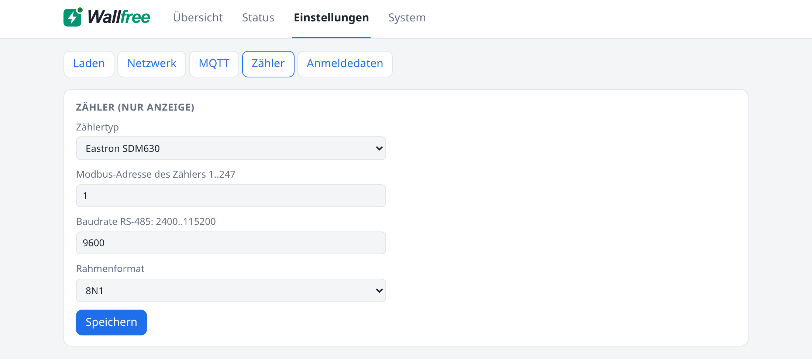

Ein Energiezähler am RS-485-Anschluss der Steuerung (Modbus RTU) liefert Messwerte für die
Anzeige, den Verlauf und ein Energiemanagement. Er dient **nur der Anzeige**: Die Steuerung
lädt ohne Zähler genauso, und Schutzfunktionen hängen nur dann von ihm ab, wenn Sie das
ausdrücklich einschalten (`contactor_monitor` = 4, `overcurrent_enable`). Den Zustand der
Verbindung zeigt [Status › Verbindungen](#62-verbindungen). Änderungen wirken nach einem Neustart.

| Parameter | Werk | Beschreibung |
| --- | --- | --- |
| Zählertyp (`meter_type`) | kein Zähler | Typ des angeschlossenen Zählers: ABB B23, Eastron SDM630, Eastron SDM72D-M V2, Eastron SDM72D-M (erste Version, nur Summenwerte). |
| Modbus-Adresse des Zählers (`meter_address`) | 1 | Busadresse, wie am Zähler eingestellt (1..247). |
| Baudrate RS-485 (`meter_baud`) | 9600 | Übertragungsgeschwindigkeit, wie am Zähler eingestellt: 2400, 4800, 9600, 19200, 38400, 57600 oder 115200. |
| Rahmenformat (`meter_framing`) | 8N1 | Datenbits, Parität und Stoppbits, wie am Zähler eingestellt: 8N1, 8E1, 8O1 oder 8N2. |

Zeigt der Zustand nach dem Neustart dauerhaft „gestört“, stimmen meist Adresse, Baudrate
oder Rahmenformat nicht mit dem Zähler überein, oder die Leitungen A/B sind vertauscht.

### 7.5 Anmeldedaten

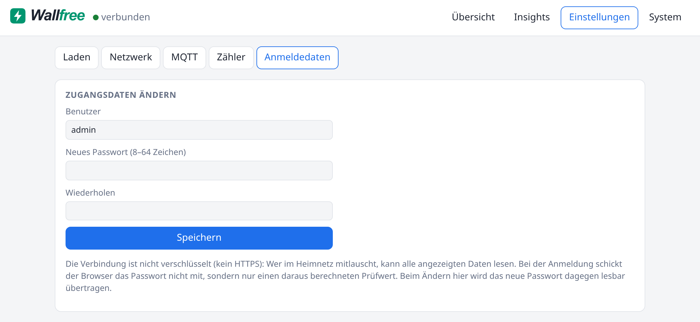

Benutzer und Passwort für die Weboberfläche und alle Programme, die auf die Steuerung
zugreifen. Vorgehen wie bei der ersten Anmeldung ([Abschnitt 3](#3-erste-anmeldung)).
Ändern Sie danach die Zugangsdaten auch im Energiemanagement (z. B. evcc).

Bei der Anmeldung überträgt der Browser das Passwort nicht, sondern nur einen daraus
berechneten Prüfwert. Beim **Ändern** wird das neue Passwort dagegen lesbar übertragen. Ändern
Sie es deshalb nur in einem vertrauenswürdigen Netz.

## 8 System

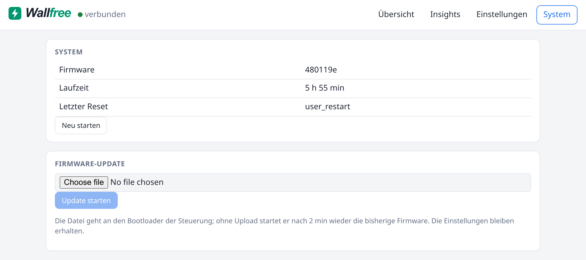

| Anzeige | Bedeutung |
| --- | --- |
| Firmware | Version der Firmware (z. B. „Wallfree 0.1“), darunter klein der Build (Stand des Quelltexts, für Fehlermeldungen) |
| Laufzeit | Zeit seit dem letzten Start |
| Letzter Reset | Grund des letzten Starts: Einschalten, Neustart auf Anforderung (Oberfläche oder Konsole), Firmware-Update, Werksreset, Reset-Taster, Spannungseinbruch, Watchdog, Überwachung bzw. Schnittstelle hing (die Überwachung hat neu gestartet; in Klammern, welche: z. B. „Ladelogik reagierte nicht“), Programmfehler (mit Programmstelle im Protokoll) |
| MAC-Adresse | Hardware-Adresse der Netzwerkschnittstelle (vom Hersteller vergeben, wie in der Originalfirmware); unter ihr kennt der Router die Wallbox, z. B. für eine feste IP-Adresse |
| Prüfsumme | Prüfsumme der laufenden Firmware; „beschädigt, Laden gesperrt“, wenn sie nicht stimmt (z. B. nach einem unvollständigen Update) |
| Letztes Update | nur nach einem Firmware-Update: erfolgreich oder fehlgeschlagen |

**Neu starten** startet die Steuerung neu, z. B. damit geänderte Netzwerk- oder
Zählereinstellungen wirken. Ein laufender Ladevorgang wird vorher geordnet beendet. Die Seite
lädt nach etwa 25 Sekunden neu. Der Verlauf beginnt danach leer, das Ereignisprotokoll bleibt;
alle Einstellungen bleiben erhalten.

**Ansicht:** Das Kästchen **Expertenansicht** schaltet die zusätzlichen Seiten und Werte ein
(Abschnitt 4). Ab Werk ist es aus. Die Wahl speichert der Browser, nicht die Steuerung; ein
anderes Gerät zeigt also wieder die einfache Ansicht, bis man sie dort umschaltet.

**Prozessortemperatur** (nur Expertenansicht): Der Sensor im Prozessor kann von Chip zu Chip um
einige Grad abweichen. Zum Abgleich die Wallbox einige Stunden stromlos lassen, damit sie die
Umgebungstemperatur annimmt, dann einschalten und kurz danach die angezeigte Temperatur
(Status → Verbindungen) mit einem Thermometer neben der Steuerung vergleichen. Den Unterschied in
°C eintragen (Komma oder Punkt, eine Nachkommastelle) und speichern, er wirkt sofort: Zeigt die
Steuerung 34 °C und das Thermometer 21,5 °C, ist der Abgleich -12,5.

**Konsole** (nur Expertenansicht): Eingabezeile für die Kommandos der Steuerung, gedacht für die
Fehlersuche, z. B. `status` (Zustand in Kurzform), `param list lock` (alle Parameter,
deren Name mit `lock` beginnt), `log` (die jüngsten Meldungen der Steuerung seit dem Start)
oder `threads` (Auslastung der Programmteile); `help`
listet alle. Die Tabulatortaste ergänzt Kommandos und Parameternamen; passende Vorschläge erscheinen
unter der Eingabezeile und lassen sich antippen (auch am Handy). Je Eingabe läuft ein Kommando, die Antwort erscheint darunter (höchstens etwa
2000 Zeichen, längere werden gekürzt). Mit Pfeil hoch und runter lassen sich frühere Eingaben
wiederholen. Kommandos wirken sofort und ohne Rückfrage, wie Änderungen in den Einstellungen.

**Lizenz:** Wallfree ist freie Software unter der Apache License 2.0. Der Link
**Lizenzhinweise** zeigt die enthaltene Software anderer Autoren mit ihren Lizenzen.

### 8.1 Firmware-Update

1. **Vorher alles anhalten, was die Wallbox abfragt** (z. B. evcc, Home Assistant) und andere
   Browser-Tabs mit der Wallbox schließen. Jede andere Anfrage während des Hochladens bricht das
   Update ab; die Steuerung bleibt dann ohne Firmware im Update-Betrieb (siehe unten).
2. Unter **Firmware-Update** die Firmware-Datei (`.bin`) auswählen. Die Seite prüft sie sofort
   und zeigt bei einer Wallfree-Datei Version und Prüfsumme. Eine ungeeignete oder beschädigte
   Datei wird abgelehnt.
3. **Update starten** und die Rückfrage bestätigen. Ein laufender Ladevorgang wird geordnet
   beendet.
4. Die Seite zeigt „Update läuft – bitte warten“ mit der verstrichenen Zeit und den Stufen
   Vorbereiten, Übertragen und Neustart. Das dauert meist weniger als eine Minute; die Steuerung ist
   in dieser Zeit nicht erreichbar, unter der Kopfzeile steht „Update läuft“. Die Seite **nicht
   schließen** (der Browser fragt sonst nach).
5. Nach „Update erfolgreich“ lädt die Seite neu. Erfolgreich heißt: Die Prüfsumme der laufenden
   Firmware stimmt mit der Datei überein. Unter System steht dann die neue Firmware und
   „Letztes Update: erfolgreich“; die Übersicht nennt das Update unter den letzten Ereignissen.

Die Einstellungen bleiben bei einem Update erhalten. Die Datei geht an den Bootloader der
Steuerung, ein eigenes kleines Programm, das unter derselben Adresse antwortet und die Firmware
annimmt. Er prüft den Inhalt nicht; deshalb prüft die Seite vorher. Eine Datei, die keine
Wallfree-Firmware ist (z. B. die Firmware des Herstellers), spielt die Seite nur nach einer
ausdrücklichen Rückfrage auf; danach ist diese Oberfläche nicht mehr erreichbar.

Bricht das Update ab, bevor die Übertragung begonnen hat, wartet der Bootloader bis zu dreimal
2 Minuten auf die Datei und startet dann wieder die bisherige Firmware. Bricht es **während** der
Übertragung ab (z. B. andere Anfrage, Netz unterbrochen), ist die bisherige Firmware schon
gelöscht. Die Seite erkennt das und überträgt die Datei bis zu zweimal neu („Übertragen
(Versuch 2 von 3)“), solange der Bootloader unter der bisherigen Adresse wartet. Scheitern alle
drei Versuche oder wird die Seite geschlossen, bleibt der Bootloader im Update-Betrieb, danach
unter **192.168.0.8**, und wartet auf eine Datei. Sie lässt sich dort auf seiner
einfachen Seite von Hand hochladen (PC dazu im Netz 192.168.0.x). Kommt die Firmware unvollständig
an, startet sie, sperrt aber das Laden („Prüfsumme … beschädigt“); dann das Update wiederholen.
Ein Fahrzeug sollte während des Updates nicht angesteckt sein.

Ist die Weboberfläche nicht erreichbar, führt der Reset-Taster zum Bootloader
([Abschnitt 9](#9-störungen-und-abhilfe), „Weboberfläche nicht erreichbar, Update nötig“).

## 9 Störungen und Abhilfe

| Störung | Ursache und Abhilfe |
| --- | --- |
| Seite nicht erreichbar | Adresse im Router prüfen; Netzwerkkabel und Netzwerk-LED prüfen. Nach Änderung der Netzwerkeinstellungen gilt die neue Adresse. |
| Anzeige „getrennt“, Inhalt grau | Verbindung unterbrochen (WLAN, Netz, Steuerung startet neu). Die Seite verbindet sich selbst neu. |
| Anmeldung wird immer wieder abgefragt | Falsche Zugangsdaten. Der Browser schickt nach einer Änderung manchmal noch die alten: neuen Tab oder privates Fenster öffnen. |
| „zu viele Fehlversuche“ | Sperre nach falschen Anmeldungen ([Abschnitt 3](#3-erste-anmeldung)). Warten (höchstens 5 Minuten) und dann richtig anmelden. Auch Programme mit veralteten Zugangsdaten (z. B. ein Energiemanagement) lösen die Sperre aus; dort die Zugangsdaten anpassen. |
| Fahrzeug lädt nicht | Übersicht: Zeile unter dem Ring („Vorgabe: Laden aus“, „Laden gesperrt“) und Kachel Fehler prüfen; Status › Fehler. Bei „Wartet auf Freigabe“ fehlt die Freigabe ([10.4](#104-freigabe-und-verfügbarkeit)). |
| Zähler „gestört“ | [7.4](#74-zähler) |
| Firmware-Update fehlgeschlagen | Unter System steht „Letztes Update: fehlgeschlagen“; es läuft die bisherige Firmware. Update wiederholen, vorher evcc und andere Abfragen anhalten. Steht die Steuerung danach im Update-Betrieb (alle LEDs der Steuerung an oder blinkend, Weboberfläche nicht erreichbar), alle Abfragen der Wallbox anhalten, die Seite des Bootloaders unter der bisherigen Adresse oder unter 192.168.0.8 öffnen und die Datei dort hochladen ([8.1](#81-firmware-update); Schritt für Schritt: [Rettungsweg](../umruesten.md#5-rettungsweg-steuerung-wartet-im-bootloader)). |
| Passwort vergessen / Steuerung unerreichbar | **Werksreset:** Reset-Taster der Steuerung gedrückt halten. Die Power-LED bleibt zunächst etwa 5 Sekunden dunkel, blinkt dann 5 Sekunden langsam und danach 5 Sekunden schnell; erst wenn sie **dauerhaft leuchtet** (insgesamt etwa 15 Sekunden), loslassen (geht auch beim Einschalten). Alle Einstellungen und die Zugangsdaten sind danach im Werkszustand (`admin` / `wallfree`, Netzwerk per DHCP). Kurzes Drücken startet die Steuerung nur neu. |
| Weboberfläche nicht erreichbar, Update nötig | **Notweg zum Bootloader:** Reset-Taster gedrückt halten, bis die Power-LED nach dem langsamen Blinken **schnell blinkt** (nach etwa 10 Sekunden), dann loslassen. Der Bootloader wartet danach unter **192.168.0.8** auf eine Firmware-Datei (PC dazu im Netz 192.168.0.x); dort die Datei hochladen ([8.1](#81-firmware-update)). Kommt keine Datei, startet nach einigen Minuten wieder die bisherige Firmware. Die Einstellungen bleiben erhalten. |

## 10 Anhang

### 10.1 DIP-Schalter und Drehschalter

Die Schalter an der Steuerung legen die Grundfunktion der Ladestation fest. Sie werden nur
beim Start gelesen; nach einer Änderung muss die Steuerung neu gestartet werden.

| DIP | Wirkung, wenn an |
| --- | --- |
| D1 | Ladestation mit Steckdose: Belastbarkeit des Ladekabels auswerten |
| D2 | Kabel mit 13 A abweisen (mit D1) |
| D3 | Kabel mit 20 A zulassen (mit D1 und D2; aus = 20-A-Kabel ebenfalls abweisen) |
| D4 | Steckerverriegelung ansteuern |
| D5 | Meldung eines Schützfehlers an einen weiteren Ausgang (ohne Wirkung auf dieser Hardware) |
| D6 | Rückmeldung der Verriegelung auswerten (Eingang mit Code 3 oder 22) |
| D7 | Laden nur mit Freigabe über einen Eingang (Code 1, 16 oder 18) |
| D8 | Verfügbarkeit über einen Eingang (Code 2) |
| D9 | Manuelle Verriegelung (Eingang Code 4 oder 17, oder `lock_request`) |
| D10 | Freigabe und Verfügbarkeit über die Schnittstelle (`enable_register`, `available_register`) |

| Drehschalter | Maximum |
| --- | --- |
| 0 | 5-%-Modus (kein Laden, siehe `pwm5_request`) |
| 1 / 2 / 3 / 4 / 5 | 6 / 10 / 13 / 16 / 20 A |
| 6 / 7 / 8 / 9 | 32 / 63 / 70 / 80 A |
| A..F | ungültig: Konfigurationsfehler, kein Laden |

Stellen Sie das Maximum nicht höher ein, als Zuleitung, Absicherung und Ladestation zulassen.

### 10.2 Eingangsfunktionen

Codes für die Parameter `in_function_ld`, `_en`, `_ml`, `_xr`, `_in`. „Ein“ bedeutet: Am
Eingang liegt Spannung an.

| Code | Funktion |
| --- | --- |
| 0 | keine |
| 1 | Freigabe, solange der Eingang ein ist (mit D7) |
| 2 | Verfügbarkeit: aus = Ladestation nicht verfügbar (mit D8) |
| 3 | Rückmeldung der Verriegelung als Dauersignal: ein = verriegelt (mit D6) |
| 4 | Manuelle Verriegelung: ein = verriegeln, aus = Laden beenden und entriegeln (mit D9) |
| 5 / 6 | Rückmeldekontakt des Schützes als Schließer / Öffner (für `contactor_monitor` 2 / 3) |
| 7 | 5-%-Modus, solange ein |
| 8 / 9 / 10 / 11 | Stromgrenze 6 / 10 / 13 / 16 A, solange ein |
| 12 / 13 / 14 / 15 | Stromgrenze 20 / 32 / 63 / 70 A, solange ein |
| 16 | Freigabe umschalten: jeder Tastendruck schaltet die Freigabe ein bzw. aus (mit D7) |
| 17 | Manuelle Verriegelung umschalten: jeder Tastendruck verriegelt bzw. entriegelt (mit D9) |
| 18 | wie 1 |
| 19 | Vorgabe der Schnittstelle ignorieren, solange ein (das Energiemanagement wird übergangen) |
| 20 | Ladepause, solange ein |
| 21 | Fehlereingang: Fehler, solange ein |
| 22 | Rückmeldung der Verriegelung als Impuls während der Motorbewegung (mit D6) |

Sind mehrere Eingänge mit derselben Funktion belegt, genügt einer (ODER). Bei mehreren
Stromgrenzen gilt die kleinste.

### 10.3 Ausgangsfunktionen

Codes für die Parameter `out_function_er`, `_lr`, `_vr`, `_cr`: Der Ausgang ist
**eingeschaltet**, solange die Bedingung gilt. Buchstaben A..F bezeichnen den Zustand der
Ladeleitung nach IEC 61851 (A kein Fahrzeug, B verbunden, C lädt, D lädt mit Lüftung,
E/F Fehler bzw. nicht verfügbar).

| Code | Bedingung |
| --- | --- |
| 0 | nie |
| 1 / 2 | A / B, ohne Fehler |
| 3 / 4 | B mit / ohne Ladesignal, ohne Fehler |
| 5 / 6 / 8 | C / D / F |
| 7 | E, oder Fehler (außer bei F) |
| 9 | A oder B, ohne Fehler |
| 10 / 11 | A, oder B mit / ohne Ladesignal, ohne Fehler |
| 12 / 13 / 14 | A oder B ohne Fehler, oder C / D / C oder D |
| 15 | E oder F oder Fehler (Sammelstörung) |
| 16 | C oder D (Fahrzeug lädt) |
| 17 | Ladesignal an |
| 18 / 19 | gültiger / kein gültiger Kabelwert |
| 20 / 21 / 22 / 23 | Kabel mit 13 / 20 / 32 / 63 A |
| 24 / 25 | Kabel mit 13 oder 20 A / 13, 20 oder 32 A |
| 26 | Kabel abgewiesen |
| 27 | Schütz ein |
| 28 | Lüftung angefordert (Laden in Zustand D) |
| 29 | Verriegelung angefordert |
| 30 / 31 / 32 / 33 | Register-Ausgang 1 / 2 / 3 / 4 (über die Schnittstelle schaltbar) |
| 34 / 35 / 36 | Fehler Überstrom / Schütz / Zustand D |
| 37 | B ohne Fehler, oder C oder D |
| 38 | A oder B, solange Eingangscode 19 aktiv ist; 1 s Nachlauf nach Schütz aus |
| 39 | Freigabe erteilt und Fahrzeug lädt (oder wartet nach einer Ladepause) |
| 40 | beim Start blinkend (1 Hz), danach wie 9 |
| 41 | A oder B ohne Fehler und ohne Ladesignal |
| 42 | Fahrzeug pausiert (Zustand B bei laufendem Ladesignal während des Ladens) |

### 10.4 Freigabe und Verfügbarkeit

- **Ladeerlaubnis** besteht, wenn mindestens eines gilt: D7 an und Freigabe-Eingang ein;
  D10 an und „Freigabe über Schnittstelle“ = 1 oder Ladestrom-Vorgabe über 0 (so startet und
  beendet ein Energiemanagement wie evcc das Laden); weder D7 noch D10 an (dann immer).
- **Laden mit dem Schlüssel unabhängig vom Energiemanagement:** Sind D7 und D10 an, lädt die
  Station bei eingeschaltetem Freigabe-Eingang (z. B. Schlüsselschalter) mit dem Höchststrom aus
  Drehschalter, Kabel und Eingängen; die Ladestrom-Vorgabe ist dann wirkungslos, auch wenn sie 0
  ist. Nach dem Ausschalten gilt sofort wieder die Vorgabe. Mit D7 allein ist der Schlüssel nur
  eine Erlaubnis, die Vorgabe wirkt weiter.
- Geladen wird nur mit Ladeerlaubnis, ohne aktiven Fehler, mit verriegeltem Stecker (bei D4)
  und mit einer Vorgabe von mindestens 6 A. Fehlt nur die Erlaubnis, zeigt die Übersicht
  „Wartet auf Freigabe“.
- **Nicht verfügbar** ist die Ladestation, wenn D8 an ist und der Verfügbarkeits-Eingang aus
  ist, oder wenn D10 an ist und „Verfügbarkeit über Schnittstelle“ = 0. Dem Fahrzeug wird
  dann Zustand F gemeldet.
- Ohne D10 wirkt die Vorgabe des Ladestroms (Übersicht, Energiemanagement) unabhängig davon:
  Vorgabe 0 sperrt das Laden, entzieht aber nicht die Freigabe.

### 10.5 Fehler

| Kennung (Status › Fehler) | Text (Status) | Bedeutung | Aufgehoben |
| --- | --- | --- | --- |
| `CABLE-REJECT` | Kabel abgewiesen | Kabel mit zu geringer Belastbarkeit (D2/D3) | anderes Kabel |
| `PP-INVALID` | PP ungültig | Kabelcodierung nicht lesbar oder kein Kabel bei verbundenem Fahrzeug | Ursache entfällt |
| `CP-INVALID` | CP ungültig | Ladeleitung kurzgeschlossen | Ursache entfällt |
| `LOCK` | Verriegeln | Steckerverriegelung fehlgeschlagen | erfolgreicher Versuch, Abstecken |
| `UNLOCK` | Entriegeln | Entriegeln fehlgeschlagen | erfolgreicher Versuch, Abstecken |
| `LD-LOST` | LD verloren | Rückmeldung der Verriegelung beim Laden weggefallen | erneutes Verriegeln, Abstecken |
| `OVERCURRENT` | Überstrom | Fahrzeug zieht zu viel Strom (`overcurrent_enable`) | Abstecken |
| `METER-COMM` | Zähler | Zähler ausgefallen, obwohl eine Schutzfunktion ihn braucht | Zähler wieder erreichbar |
| `STATE-D` | Zustand D | Fahrzeug fordert Lüftung an (`reject_state_d`) | Abstecken |
| `CONTACTOR` | Schütz | Schütz öffnet nicht wie befohlen | Quittieren oder Neustart, wenn behoben |
| `DIODE` | Diode | Fahrzeugseite der Ladeleitung fehlerhaft | Abstecken |
| `INPUT` | Eingang | Fehlereingang (Code 21) aktiv | Eingang aus |
| `RCM-SELFTEST` | RCM-Selbsttest | Selbsttest der Fehlerstromüberwachung fehlgeschlagen | bestandener Selbsttest |
| `RCM-SENSOR` | RCM-Sensor | Sensor der Fehlerstromüberwachung meldet einen Fehler | bestandener Selbsttest |
| `RCM-DC6` | RCM 6 mA DC | Gleichfehlerstrom erkannt | bestandener Selbsttest |
| `RCM-AC30` | RCM 30 mA AC | Wechselfehlerstrom erkannt | bestandener Selbsttest |
| `SWITCH` | Drehschalter | Drehschalter auf A..F | Korrektur und Neustart |
| `CONFIG` | Konfiguration | Einstellungen widersprechen sich (z. B. D6 ohne Eingang mit Code 3 oder 22) | Korrektur |
| `INTERNAL` | Intern | interne Prüfung angesprochen | Neustart |

Bei einem Fehlerstrom oder einem Fehler der Fehlerstromüberwachung lassen Sie die
Installation von einer Elektrofachkraft prüfen, bevor Sie weiter laden.

---

*Wallfree ist freie Software unter der Apache-Lizenz 2.0 und steht in keiner Verbindung zum
Hersteller der Ladesteuerung.*
