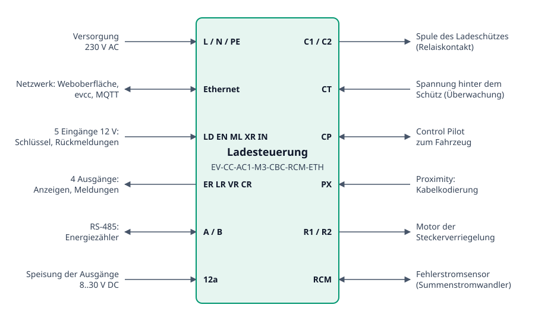

# Hardware der Ladesteuerung

Diese Seite beschreibt die Ladesteuerung **EV-CC-AC1-M3-CBC-RCM-ETH** (Phoenix Contact), wie
Wallfree sie benutzt: Anschlüsse, Drehschalter, DIP-Schalter, Ein- und Ausgänge, LEDs und
Reset-Taster. Sie ersetzt nicht das Handbuch des Herstellers. Für Lage und Nummern der Klemmen,
Anschlussquerschnitte und Grenzwerte gilt das Handbuch der Steuerung; die Angaben hier stammen
aus der Analyse der Originalfirmware und aus Prüfungen an zwei Ladestationen wallbe Eco 2.0
([Prüfprotokoll](pruefprotokoll.md)).

**Arbeiten an der Ladestation sind Sache einer Elektrofachkraft.** In der Ladestation liegt
Netzspannung an, auch an den Klemmen der Steuerung. DIP-Schalter und Drehschalter nur im
spannungsfreien Zustand verstellen.

## 1 Anschlüsse

Das Bild zeigt die Funktion der Anschlüsse, nicht ihre Lage auf der Steuerung.

| Klemme | Funktion | Bei Wallfree |
| --- | --- | --- |
| L, N, PE | Versorgung 230 V AC | – |
| C1, C2 | Relaiskontakt für die Spule des Ladeschützes | schaltet nur beim Laden; die Last fließt nie über die Steuerung |
| CT | misst, ob hinter dem Ladeschütz Spannung anliegt | Schützüberwachung ab Werk über diese Klemme (`contactor_monitor` = 1) |
| C3, C4 | zweiter Relaiskontakt | schaltet zusammen mit C1/C2, nicht getrennt ansteuerbar |
| CP | Control Pilot zum Fahrzeug | ±12 V, PWM 1 kHz; meldet den erlaubten Ladestrom, liest den Zustand des Fahrzeugs |
| PX | Proximity: Belastbarkeit des Ladekabels (Widerstand gegen PE) | ausgewertet mit DIP D1 (Ladestation mit Steckdose) |
| R1, R2 | Motor der Steckerverriegelung, 12 V, Impuls in beide Richtungen | mit DIP D4 |
| RCM | Fehlerstromsensor (Summenstromwandler um die Ladeleitungen) | 6 mA Gleich- und 30 mA Wechselfehlerstrom, Selbsttest vor jedem Laden |
| LD, EN, ML, XR, IN | fünf Digitaleingänge | Funktion je Eingang einstellbar ([Abschnitt 4](#4-digitaleingänge)) |
| ER, LR, VR, CR | vier Digitalausgänge | Funktion je Ausgang einstellbar ([Abschnitt 5](#5-digitalausgänge)) |
| 12a | Speisung der Ausgänge, 8..30 V DC | ohne sie schalten die Ausgänge nicht |
| 12 V, GND | Hilfsspannung 12 V DC (bis 200 mA) und Bezugspotential | z. B. für Schlüsselschalter an EN und als Speisung an 12a |
| A, B | RS-485 für Modbus RTU | Energiezähler ([Abschnitt 6](#6-energiezähler-an-ab)) |
| Ethernet (RJ45) | Netzwerk 10/100 Mbit/s | Weboberfläche, API, evcc, MQTT, Firmware-Update |
| SIM, Antenne | Mobilfunk (nur bei Ausführungen mit Modem) | nicht benutzt |

## 2 Drehschalter: höchster Ladestrom

Der Drehschalter legt den höchsten Strom fest, den die Ladestation dem Fahrzeug je erlaubt. Alle
anderen Vorgaben (Weboberfläche, evcc, Ladekabel, Eingänge) können ihn nur verringern.

| Stellung | Höchststrom |
| --- | --- |
| 0 | 5-%-Modus: kein Laden (digitale Kommunikation, die die Steuerung nicht unterstützt) |
| 1 / 2 / 3 / 4 / 5 | 6 / 10 / 13 / 16 / 20 A |
| 6 / 7 / 8 / 9 | 32 / 63 / 70 / 80 A |
| A..F | ungültig: Konfigurationsfehler, kein Laden |

Den Wert nicht höher einstellen, als Zuleitung, Absicherung, Ladeschütz und Ladekabel zulassen.
Bei dreiphasigem Anschluss entsprechen 16 A etwa 11 kW und 32 A etwa 22 kW.

## 3 DIP-Schalter: Betriebsart

Zehn Schalter D1..D10 legen fest, welche Funktionen der Ladestation benutzt werden.

| DIP | Wirkung, wenn an |
| --- | --- |
| D1 | Ladestation mit Steckdose: Belastbarkeit des Ladekabels (PX) auswerten |
| D2 | Kabel mit 13 A abweisen (mit D1) |
| D3 | Kabel mit 20 A zulassen (mit D1 und D2; aus = 20-A-Kabel ebenfalls abweisen) |
| D4 | Steckerverriegelung ansteuern (R1, R2) |
| D5 | Meldung eines Schützfehlers an einen weiteren Ausgang; auf dieser Hardware ohne sichtbare Wirkung |
| D6 | Rückmeldung der Verriegelung auswerten (ein Eingang mit Code 3 oder 22) |
| D7 | Laden nur mit Freigabe über einen Eingang (Code 1, 16 oder 18), z. B. Schlüsselschalter |
| D8 | Verfügbarkeit über einen Eingang (Code 2) |
| D9 | Manuelle Verriegelung (Eingang mit Code 4 oder 17) |
| D10 | Freigabe über die Ladestrom-Vorgabe der Schnittstelle: Vorgabe über 0 gibt frei. So startet und beendet ein Energiemanagement wie evcc das Laden |

Drehschalter und DIP-Schalter liest die Steuerung **nur beim Start**. Nach einer Änderung neu
starten (Weboberfläche → System, oder Versorgung aus und ein). Die gelesene Stellung zeigt die
Weboberfläche in der Expertenansicht unter Status → Ladelogik.

Typische Einstellungen:

| Ladestation | DIP an |
| --- | --- |
| mit fest angeschlossenem Ladekabel, ohne Schlüsselschalter, mit evcc | D10 |
| mit Steckdose und Verriegelung mit Rückmeldung, mit Schlüsselschalter | D1, D2, D3, D4, D6, D7 |
| wie vor, zusätzlich mit evcc; der Schlüssel lädt unabhängig von evcc | D1, D2, D3, D4, D6, D7, D10 |

Wie Freigabe, Schlüsselschalter und Energiemanagement zusammenwirken:
[Bedienungsanleitung, Abschnitt 10.4](anleitung/weboberflaeche.md#104-freigabe-und-verfügbarkeit).

## 4 Digitaleingänge

Fünf Eingänge LD, EN, ML, XR und IN. Ein Eingang gilt als **ein** über etwa 9 V und als **aus**
unter etwa 3 V gegen GND; dazwischen bleibt der letzte Zustand. Üblich ist ein Kontakt zwischen
der Klemme 12 V und dem Eingang. Ein Wechsel wird nach etwa 16 ms übernommen.

Jeder Eingang kann jede Funktion übernehmen (Einstellungen → Laden, Expertenansicht). Die
Namen der Klemmen entsprechen nur der Werkseinstellung:

| Eingang | Parameter | Werkseinstellung |
| --- | --- | --- |
| LD | `in_function_ld` | 3: Rückmeldung der Verriegelung als Dauersignal |
| EN | `in_function_en` | 1: Freigabe (wirkt mit D7) |
| ML | `in_function_ml` | 4: manuelle Verriegelung (wirkt mit D9) |
| XR | `in_function_xr` | 2: Verfügbarkeit (wirkt mit D8) |
| IN | `in_function_in` | 11: Stromgrenze 16 A, solange ein |

Weitere Funktionen sind zum Beispiel Stromgrenzen von 6 bis 70 A, Ladepause, Fehlereingang,
Rückmeldekontakt des Schützes und „Vorgabe der Schnittstelle ignorieren“. Alle Codes:
[Bedienungsanleitung, Abschnitt 10.2](anleitung/weboberflaeche.md#102-eingangsfunktionen).

**Wichtig bei wallbe-Ladestationen:** Der Verriegelungsmotor meldet seine Stellung nur mit einem
kurzen Impuls während der Fahrt. Dafür muss LD auf **22** stehen; mit der Werkseinstellung 3
schlägt das Verriegeln fehl.

## 5 Digitalausgänge

Vier Ausgänge ER, LR, VR und CR schalten die an **12a** eingespeiste Spannung (8..30 V DC) auf
die Klemme, je Ausgang bis etwa 0,6 A. In der wallbe Eco 2.0 treiben sie die farbige Anzeige an
der Front.

| Ausgang | Parameter | Werkseinstellung |
| --- | --- | --- |
| ER | `out_function_er` | 15: Sammelstörung (Fehler oder Zustand E/F) |
| LR | `out_function_lr` | 29: Verriegelung angefordert |
| VR | `out_function_vr` | 16: Fahrzeug lädt (Zustand C oder D) |
| CR | `out_function_cr` | 17: Ladesignal (PWM) an |

Es gibt 43 Funktionen, darunter Zustände des Fahrzeugs, Kabelklassen, einzelne Fehler und vier
„Register-Ausgänge“, die sich über die Schnittstelle schalten lassen. Alle Codes:
[Bedienungsanleitung, Abschnitt 10.3](anleitung/weboberflaeche.md#103-ausgangsfunktionen).

## 6 Energiezähler an A/B

An A und B liest Wallfree einen Energiezähler über Modbus RTU, nur zur Anzeige und für evcc,
nicht für Schutzfunktionen. Unterstützt sind ABB B23, Eastron SDM630 und Eastron SDM72D-M.
Adresse, Baudrate und Format stehen unter Einstellungen → Zähler (ab Werk Adresse 1, 9600 Bd,
8N1).

Die Beschriftung A/B ist zwischen Herstellern nicht einheitlich. Antwortet der Zähler nicht
(Fehlerzähler „timeouts“ unter Status), die beiden Adern am Zähler tauschen. Bei einem ABB B23
war das nötig; ein USB-Adapter arbeitete mit D+ an A und D− an B.

## 7 LEDs

| LED | Bedeutung |
| --- | --- |
| Power (grün) | blinkt langsam (1 Hz), solange Wallfree läuft |
| Error (rot) | an bei jedem aktiven Fehler und wenn die Ladestation nicht verfügbar ist |
| Connect (gelb) | an: Stecker verriegelt; blinkt: Ladekabel erkannt (mit D1); sonst aus |
| Ready (grün) | an: Schütz ein, es wird geladen; blinkt schnell (2 Hz): Ladesignal an, Fahrzeug lädt noch nicht; blinkt langsam (1 Hz): Fahrzeug verbunden; aus: kein Fahrzeug |
| grüne LED an der Netzwerkbuchse | an: Netzwerk verbunden und Adresse vorhanden; blinkt: kein Kabel oder keine Adresse |
| alle vier LEDs blinken schnell gemeinsam | der Bootloader wartet auf eine Firmwaredatei ([Umrüsten](umruesten.md)) |

## 8 Reset-Taster

Kurz gedrückt startet die Steuerung neu; die Einstellungen bleiben. Nach dem Drücken bleibt sie
etwa 5 Sekunden dunkel, bevor sie startet. Wird der Taster dabei **gehalten**, zeigt die
Power-LED, was beim Loslassen geschieht:

| Power-LED | Loslassen bewirkt |
| --- | --- |
| dunkel (etwa 5 s), dann langsames Blinken (weitere 5 s) | normaler Start |
| schnelles Blinken (danach, 5 s lang) | **Notweg zum Bootloader:** Er wartet unter 192.168.0.8 auf eine Firmwaredatei; die Einstellungen bleiben ([Umrüsten, Abschnitt 4](umruesten.md#4-wenn-etwas-schiefgeht)) |
| dauerhaft an (nach insgesamt etwa 15 s) | **Werksreset:** alle Einstellungen von Wallfree auf Werkseinstellung, Zugang wieder `admin` / `wallfree`. Die Einstellungen der Originalfirmware bleiben unberührt |

## 9 Weiterlesen

- Einstellungen in der Weboberfläche: [Bedienungsanleitung](anleitung/weboberflaeche.md).
- Was Wallfree anders macht als die Originalfirmware:
  [Unterschiede](unterschiede-originalfirmware.md).
- Zuordnung der Klemmen zu den Pins des Prozessors und alle Anforderungen:
  [Soll-Spezifikation, Abschnitt 2](soll-spezifikation.md#2-klemmen-und-signale).
