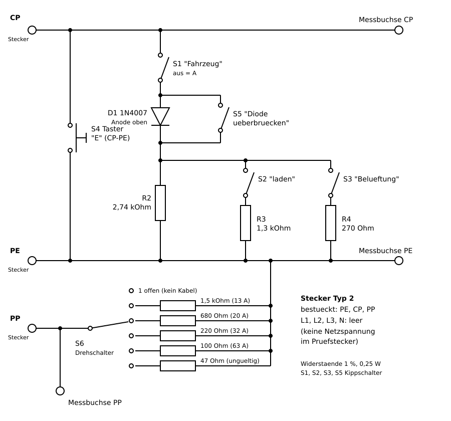

# Prüfstecker und Stufe C

Stand: 2026-11-07. Plan für einen selbstgebauten Prüfstecker (Fahrzeugnachbildung an der
Typ-2-Steckdose) und den Prüfablauf der Stufe C auf dem Testgerät (CP-PWM, Verriegelung mit Stecker,
Fehlerstrom, Schütz, evcc). Prüfstecker gebaut (Nutzer 2026-11-07). Stufe C ist freigegeben
([Abschnitt 7](#7-freigabe-stufe-c)) und auf dem Testgerät durchgeführt (C1..C6, 2026-11-07; Ergebnisse in
[Implementierung](implementierung.md#prüfungen-auf-box-t)).

## 1. Grundsatz: keine Netzspannung im Prüfstecker

Der Prüfstecker ist ein Typ-2-Stecker, in dem **nur PE, CP und PP bestückt** sind; die
Kontakte L1, L2, L3 und N bleiben **leer** (Kontakthülsen nicht einsetzen). Schaltet das Schütz
ein, liegt die Netzspannung nur an den Buchsenkontakten in der Steckdose, die der eingesteckte
Stecker abdeckt; in den Prüfstecker, seine Schalter und Messbuchsen gelangt sie nicht. CP und PP
führen nur Kleinspannung (+-12 V bzw. die PP-Messspannung) gegen PE.

Die Netzspannung am Schützausgang misst der Nutzer bei Bedarf an den großen Klemmen in der
Wallbox (Nutzerregel: Klemmen ja, Platine nein).

## 2. Schaltung

Werte der Fahrzeugseite nach IEC 61851-1 Anhang A (Norm nicht im Projekt; Werte allgemein
veröffentlicht und über die Bandgrenzen in [SOLL-CP-01](soll-spezifikation.md#4-cp--und-pp-auswertung)
gegengeprüft).

| Stellung | CP gegen PE (Fahrzeugseite) | erwarteter CP-Pegel (positives Plateau) |
| --- | --- | --- |
| S1 aus | offen | +12 V (A) |
| S1 ein | D1 + 2,74 kOhm | etwa +9 V (B) |
| S1 + S2 | D1 + 882 Ohm (2,74k ‖ 1,3k) | etwa +6 V (C) |
| S1 + S3 | D1 + 246 Ohm (2,74k ‖ 270) | etwa +3 V (D, wird abgewiesen: `reject_state_d` = 1) |
| S4 gedrückt | Kurzschluss CP-PE | 0 V (E, ERR-CP-INVALID) |
| S5 gedrückt (mit S1) | ohne Diode | negatives Plateau etwa -8,8 V statt -12 V (ERR-DIODE) |

Die Pegel gelten für einen Quellwiderstand von 1 kOhm in der Wallbox (Norm; beim Testgerät nicht
gemessen). Die Diode sitzt **zwischen** S1 und den Widerständen (Anode zur CP-Seite, nur die positive
Halbwelle fließt), der Taster S4 schließt CP
direkt nach PE (vor der Diode).

PP-Klassen der Steckdose mit D1 an ([SOLL-PP-02](soll-spezifikation.md#43-pp-proximity-klemme-px)):

| S6 | Widerstand PP-PE | Wallfree `cable` | Bemerkung beim Testgerät (DIP 111: D1, D2, D3 an) |
| --- | --- | --- | --- |
| offen | > 2,2 kOhm | 0 | kein Kabel |
| 1 | 1,5 kOhm | 13 A | **ERR-CABLE-REJECT** (D2 an) |
| 2 | 680 Ohm | 20 A | zugelassen (D3 an) |
| 3 | 220 Ohm | 32 A | Normalfall für die Prüfung |
| 4 | 100 Ohm | 63 A | wird als 63 A gemeldet |
| 5 | 47 Ohm | ungültig | **ERR-PP-INVALID** |

S5 ist ein Taster: Wallfree erkennt die fehlende Diode nach 20 ms und hält den Fehler bis zum
Abstecken (SOLL-CP-07), ein kurzer Druck (etwa 0,5 s) reicht. Ein Kippschalter geht ebenso.

Schalter als Kippschalter (S1, S2, S3) statt eines Drehschalters für A..D: Ein
Drehschalter unterbricht beim Umschalten kurz (wirkt wie A). Die CP-Entprellung (20 ms)
überbrückt das zwar meist, Kippschalter bilden das Fahrzeug aber näher nach (R2 bleibt
immer verbunden, S2/S3 schalten zu).

## 3. Stückliste

| Teil | Angabe | Hinweis |
| --- | --- | --- |
| Typ-2-Stecker | Ladekabelstecker (Infrastrukturseite, passt in die Steckdose), zum Selbstkonfektionieren, mit Einzelkontakten | nur PE-, CP-, PP-Kontakt einsetzen; Markenware (z. B. Phoenix Contact, Mennekes), damit Verriegelung und Kodierung stimmen |
| Leitung | 3 Adern, z. B. 3 x 0,75 mm², etwa 1 m, mit Zugentlastung | PE grün-gelb; kein Laststrom |
| Gehäuse | isolierend, klein | Leitungseinführung mit Zugentlastung |
| D1 | 1N4007 (oder 1N4148) | Sperrspannung >= 50 V reicht |
| R2 | 2,74 kOhm 1 % (E96), sonst 2,7 kOhm 1 % | 0,25 W |
| R3 | 1,3 kOhm 1 % | 0,25 W |
| R4 | 270 Ohm 1 % | 0,25 W |
| PP-Widerstände | 1,5 kOhm, 680 Ohm, 220 Ohm, 100 Ohm, 47 Ohm, je 1 % | 0,25 W |
| S1, S2, S3 | Kippschalter 1 x Ein/Aus | Kleinspannung, beliebig |
| S4, S5 | Taster (Schließer) | S4 Kurzschluss CP-PE, S5 überbrückt D1 |
| S6 | Drehschalter 1 x 6 | PP-Klassen |
| Messbuchsen | 3 x 4-mm-Sicherheitsbuchse (CP, PP, PE) | für Multimeter/Oszilloskop |

Zubehör für die Fehlerstromprüfung (C4), getrennt vom Stecker:

| Teil | Angabe | Hinweis |
| --- | --- | --- |
| Prüfdraht | isolierte Litze, etwa 0,5 mm², 1..2 m | einmal durch den gelben Summenstromwandler, nur spannungsfrei einziehen |
| Batterie | 9-V-Block mit Clip | Stromquelle für Prüfdraht und Kontaktschleife |
| R5 | 1 kOhm, 0,25 W | etwa 9 mA Gleichstrom im Prüfdraht (Auslöseschwelle 6 mA DC) |
| S7 | Taster (Schließer) | schaltet den Fehlerstrom |
| R6 | 4,7 kOhm, 0,25 W | Kontaktschleife über C1/C2 (nur nach Bedingung in C4) |
| Oszilloskop | 2 Kanäle | vorhanden |

Belastung: Der höchste Strom fließt bei S4 (12 V über 1 kOhm, etwa 12 mA); alle Widerstände
bleiben weit unter 0,25 W.

## 4. Spannungsfreie Prüfung des Steckers

Vor dem ersten Stecken, Stecker nicht in der Wallbox, mit dem Multimeter zwischen den
Steckerkontakten (nicht nur an den Messbuchsen):

| Prüfung | Erwartet |
| --- | --- |
| L1, L2, L3, N gegen alles | offen (Kontakte leer) |
| CP-PE, S1 aus | offen |
| CP-PE, S1 ein, Diodentest (Rot an CP) | Durchlass etwa 0,6 V; umgekehrt gesperrt |
| CP-PE, S1 ein, Widerstand mit Rot an CP | etwa 2,7 kOhm + Diode (Anzeige je nach Messgerät höher) |
| wie vor, S2 zu / S3 zu | kleiner (882 Ohm / 246 Ohm + Diode) |
| CP-PE, S4 gedrückt | 0 Ohm |
| CP-PE, S1 ein, S5 gedrückt | 2,74 kOhm, in beiden Richtungen gleich |
| PP-PE je Stellung S6 | offen, 1,5k, 680, 220, 100, 47 Ohm |

## 5. Prüfablauf Stufe C

Probe in der Simulation: `T8StufeC` in [tests/e2e/test_e2e.py](../tests/e2e/test_e2e.py) spielt C1..C4
und die WARP-Seite von C6 mit den Einstellungen des Testgeräts durch (DIP 111, Drehschalter 4, LD 22,
CR 40; Schalter -> `sim`-Kommandos) und prüft die Erwartungen dieses Abschnitts; Pegel und Zeiten
am Oszilloskop zeigt sie nicht.

Allgemein: Wallfree wird nur über Shell und API gesteuert; der Nutzer schaltet F1, bedient die
Schalter am Prüfstecker und misst an CP/PE (Messbuchsen) bzw. an großen Klemmen. Vor jedem
Schritt nennt Claude Aktion und Beobachtungspunkte. Abbruch: unerwartetes Schützklicken,
Geruch, Motor läuft dauerhaft -> F1 aus.

Rahmen am Testgerät (Nutzer 2026-10-24): "Schütz abgeklemmt" heißt **Spule abgeklemmt**; die
Steckdose hat eine **Notentriegelung**; ein **Oszilloskop** ist vorhanden (CP-PWM, Pegel und
Reaktionszeiten direkt messen, Tastkopf an den Messbuchsen CP/PE des Prüfsteckers).
`unlock_check` bleibt aus.

**C0 Vorbereitung.** Prüfstecker nach Abschnitt 4 geprüft. Schützspule abklemmen (sie ist derzeit angeschlossen); der Nutzer bestätigt vor dem ersten Schritt, was an C1/C2 und an der Spule hängt.

**C1 Stecker ohne Fahrzeug (S1 aus), PP-Klassen.** Stecker stecken, S6 nacheinander durch alle
Stellungen, je > 1 s warten (SOLL-PP-03).

| S6 | Erwartet (`param get cable`, `errors`) |
| --- | --- |
| offen | `cable` 0, keine Fehler |
| 1,5k | 13 A, ERR-CABLE-REJECT |
| 680 / 220 / 100 | 20 / 32 / 63 A, keine Fehler |
| 47 | ERR-PP-INVALID |

Dabei bleibt CP +12 V DC, Zustand S1, nicht verriegelt; D9 aus verriegelt erst bei Fahrzeug (B).
Bei den Fehlern zeigt `status` "CP E": Das ist der gemeldete Status (mit Fehler E,
SOLL-CP-08), nicht der Pegel.

**C2 Fahrzeug erkannt (B), PWM.** S6 auf 220 Ohm (32 A), Schlüssel ein, S1 ein.

- Erwartet: Verriegeln (Motor, LD-Impuls, Connect-LED an), RCM-Selbsttest (im Protokoll als
  Zustandsfolge S3 -> S4 -> S5, kein eigenes Ereignis), S5 PWM_ON, PWM
  1 kHz mit 26,6 % (16 A, Drehschalter 4), `cp_pos` etwa 9 V, `cp_neg` etwa 12 V, Ready-LED
  2 Hz, Front-LED grün (CR 40: B ohne Fehler).
- Multimeter (DC) an CP-PE zeigt den Mittelwert, etwa 0,266 * 9 V - 0,734 * 12 V = **-6,4 V**.
- Strom über die Schnittstelle: `current 10000` -> Tastgrad 16,6 % (abgeschnitten), Mittelwert etwa
  -8,5 V; zurück mit `current 80000`.
- Schlüssel aus -> Ladeerlaubnis weg, PWM aus (CP +9 V DC); Schlüssel ein -> PWM wieder an.
- Nach `wakeup_delay` (30 s) in B: Weckfolge einmal je Steckvorgang, 3 s -12 V DC, 0,75 s
  +12 V DC, dann wieder PWM; kein Protokolleintrag, nur am Oszilloskop zu sehen (Zustand bleibt S5).
- S1 aus (A) -> PWM aus, Entriegeln (Motor), S1.

**C3 Laden ohne Schützspule (C).** S1 ein, warten bis PWM, dann S2 ein.

- Erwartet: S6 CHARGING, `contactor` (Soll) 1, Ready-LED an, Front-LED blau (VR 16: C oder D);
  kein Klicken, weil die Spule abgeklemmt ist; an der Steckdose keine Netzspannung.
- Relais C3/C4: schließt mit C1/C2 (Testgerät 2026-11-07, Durchgang C3-C4, an C3/C4 nichts angeschlossen).
- S2 aus (B) -> Schütz-Soll aus, PWM bleibt; S2 ein -> wieder ein (frühestens nach `contactor_min_off`, ab Werk 5 s).
- S3 statt S2 (D) -> ERR-STATE-D, Schütz-Soll aus.
- S4 kurz drücken während C -> ERR-CP-INVALID, Schütz-Soll sofort aus; nach dem Loslassen
  (>= 1,2 V) erlischt der Fehler und es lädt ohne Abstecken wieder (SOLL-SM-91, wie Original).
- S5 kurz drücken während PWM -> ERR-DIODE, CP 3 s -12 V, dann +12 V (SOLL-CP-07), Schütz-Soll aus;
  der Fehler bleibt nach dem Loslassen bis zum Abstecken (S1 aus).
- Schlüssel aus während C -> S7 STOPPING, PWM aus; Schütz-Soll bleibt, bis S2 aus (das
  Fahrzeug reagiert) oder nach `stop_timeout` 5 s, dann S3.
- Die Schützüberwachung (Via Sense, CT) prüft nur im Aus-Zustand; ohne Spule bleibt sie
  ruhig. Ein ERR-CONTACTOR hier wäre ein Befund (CT-Beschaltung).

**C4 Fehlerstrom und Reaktionszeit (ohne Schützspule).** Ziel: SOLL-PROT-04/05/07/08/11
auf der Hardware, Zeit vom Fehlerstrom bis zum Abschalten (Bender verlangt Schütz aus binnen
20 ms, Wallfree-Anteil <= 1 ms). Fehlerstrom ohne Netzspannung: Gleichstrom über einen
zusätzlichen Draht durch den Summenstromwandler.

Aufbau (Nutzer, F1 aus): Prüfdraht einmal durch den gelben Ringkern führen, außerhalb der
Wallbox: Batterie + -> R5 -> S7 -> Prüfdraht -> Batterie -. Der Draht berührt keine Klemmen.

- **C4a Fehlerstrom im Ruhezustand (kein Stecker).** S7 kurz drücken. Erwartet: ERR-RCM-DC6
  (SWITCH_2), Front-LED rot, Ereignis im Log; nach dem Loslassen Selbsttest in A frühestens 30 s
  nach dem letzten Versuch (`rcm_retest_interval`), bestanden -> Fehler gelöscht. S7 gedrückt
  halten während des Selbsttests -> Selbsttest scheitert, Fehler bleibt (Gegenprobe).
- **C4b Fehlerstrom beim Laden.** Prüfstecker wie C3 (S1 + S2, S6 CHARGING, Schütz-Soll 1),
  dann S7. Erwartet: Schütz-Soll sofort 0, CP +12 V DC, ERR-RCM-DC6 verriegelt (nur DC6; die
  Simulation setzt immer DC6 und AC30 zusammen). S2/S1 aus und
  wieder ein lädt nicht, bis in A (S1 aus) ein Selbsttest bestanden hat (SOLL-PROT-08/11).
- **C4c Reaktionszeit.** Durchgeführt an **C3/C4** (schaltet mit C1/C2 über PE2, nichts angeschlossen, keine
  Änderung an C1/C2 nötig): Batterie + -> R6 -> C3, C4 -> Batterie -; Kanal 1 zwischen R5 und S7 (fällt mit dem
  Fehlerstrom), Kanal 2 an C3 (steigt beim Öffnen). Ergebnis das Testgerät: 2,5..3 ms. Ursprünglicher Plan an C1/C2:
  Messpunkt für das Abschalten ist der Relaiskontakt C1/C2; PE2 auf der
  Platine erst, wenn ein Messpunkt bekannt ist (Fotos). Bedingung für die Kontaktschleife: Der
  Nutzer hat beide Adern an C1 und C2 spannungsfrei abgeklemmt und mit F1 ein gemessen, dass an
  C1 und C2 gegen PE, L und N **keine Spannung** liegt, bei offenem und (in C3) geschlossenem
  Relais. Liegt Spannung an, entfällt C4c in dieser Form. Schleife: Batterie + -> R6 -> C1,
  C2 -> Batterie -; Oszilloskop-Masse an Batterie -, Kanal 1 hinter S7 (springt mit dem
  Fehlerstrom), Kanal 2 an C1 (0 V bei geschlossenem Relais, 9 V nach dem Öffnen). Auslösen
  auf Kanal 1. Gemessen wird Sensor + Software + Relaisabfall zusammen; Sollwert < 20 ms.
  Drei Wiederholungen; Claude liest dazu Fehler und Log.
- Der AC-Zweig (SWITCH_1, 30 mA rms) bleibt ungeprüft: dafür bräuchte es einen Wechselstrom
  von 30 mA im Prüfdraht.

**C5 Laden mit Schütz.** F1 aus, Prüfdraht entfernen, Adern an C1/C2 wieder anklemmen und
Schützspule anschließen (Nutzer, spannungsfrei), F1 ein. Wiederholen von C3:

Ab hier wird der Prüfstecker nur bei F1 aus gezogen oder gesteckt: Ohne Stecker wären die
Buchsenkontakte offen, und bei eingeschaltetem Schütz läge dort Netzspannung.

- Schütz klickt bei C, fällt bei B, E, Diodenfehler, Schlüssel aus.
- `ct_sense` 1 bei eingeschaltetem Schütz, 0 nach dem Abschalten (Via Sense).
- Optional misst der Nutzer an den großen Klemmen am Schützausgang L-N (230 V bei ein, 0 V bei
  aus); am Prüfstecker liegt keine Netzspannung (Abschnitt 1).
- Nach jedem Aus: kein ERR-CONTACTOR (Via Sense sieht keine Spannung mehr).

**C6 evcc.** evcc auf dem PC (Docker wie in [Test und Simulation](test-und-simulation.md#evcc-gegen-die-simulation),
Vorlage `tinkerforge-warp-ws`, eigene Konfiguration gegen das Testgerät, Zugangsdaten des Testgeräts),
Schützspule wie in C5. Erwartet: evcc verbindet; S1 ein -> "connected", S2 ein -> "charging";
Modus Aus -> Ladestrom 0 = Stromsperre: PWM aus (CP +12 V DC), Schütz fällt, sobald S2 aus ist,
sonst nach `stop_timeout` 5 s; Modus Sofort -> PWM und Schütz wieder ein;
Strom in evcc ändern -> Tastgrad folgt; S1 aus -> "disconnected". Ohne Zähler und ohne Last
zeigt evcc keine Leistung.

**C7 offen für später.** Echtes Fahrzeug (H3), Fehlerstrom während des Ladens mit Last, AC-Zweig.

## 6. Bezug zu den Anforderungen

C1: SOLL-PP-01..05. C2: SOLL-CP-01..05, SOLL-LOCK-14/23, SOLL-EN-01, SOLL-LED-03/04,
SOLL-CUR. C3/C5: SOLL-SM, SOLL-CP-06/07, SOLL-PROT-20/21, SOLL-RT-20. C4: SOLL-PROT-04/05/07/08,
SOLL-PROT-10..12, SOLL-CP-09. C6: evcc-Anbindung (WARP-Schnittstelle). Ergebnisse werden in
[Implementierung](implementierung.md#offen) und [wallbe2 Hardware](../../wallbe2/docs/hardware.md)
eingetragen.

## 7. Freigabe Stufe C

Erteilt (Nutzer 2026-10-30); der verbindliche Wortlaut steht in den Sicherheitsgrenzen von
[wallbe2/AGENTS.md](../../wallbe2/AGENTS.md). Sie gilt für C1..C6 am Testgerät ohne Fahrzeug und Last.
Nicht enthalten: C7, die Befehle `bootloader`, `factory-reset` und `import-original`.
