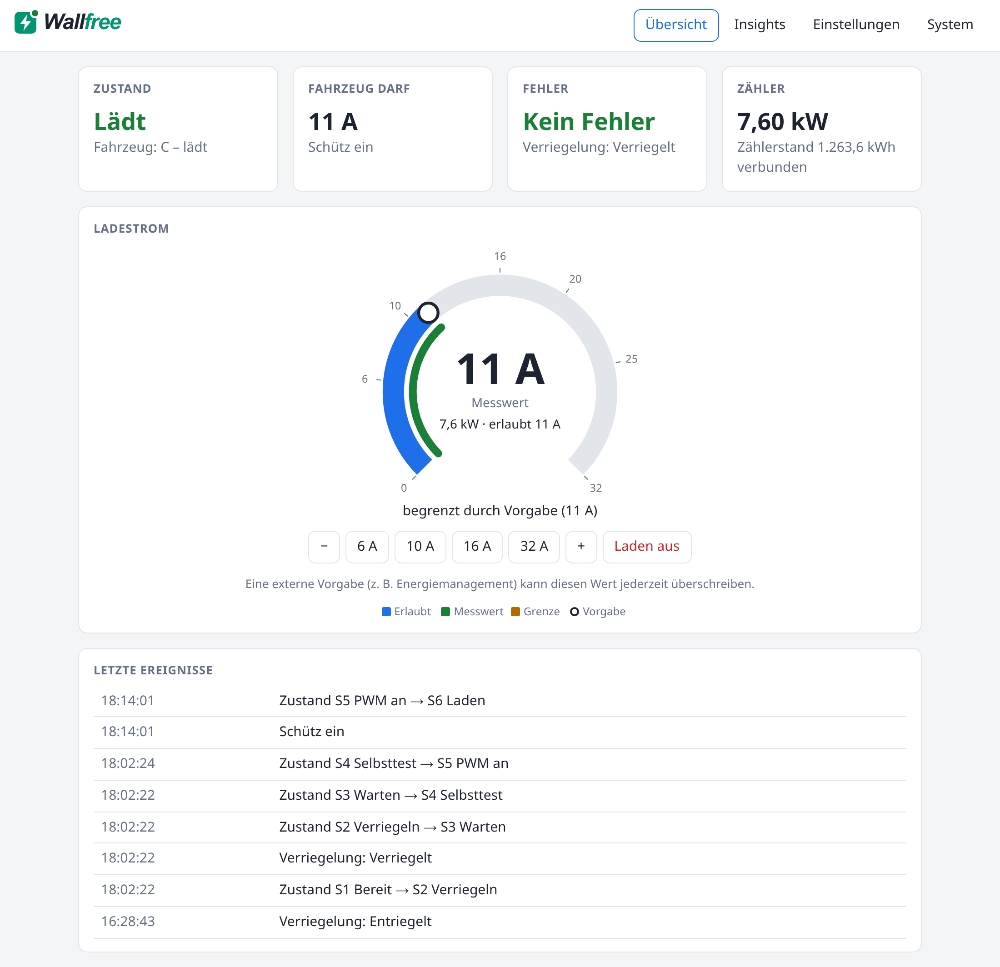
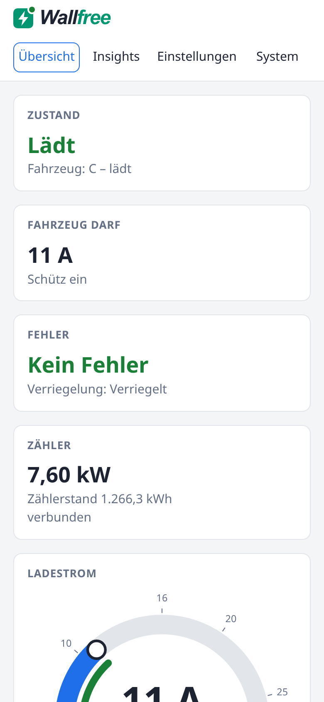
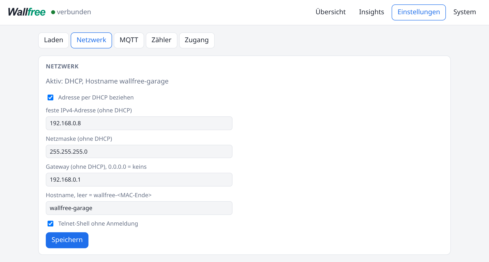
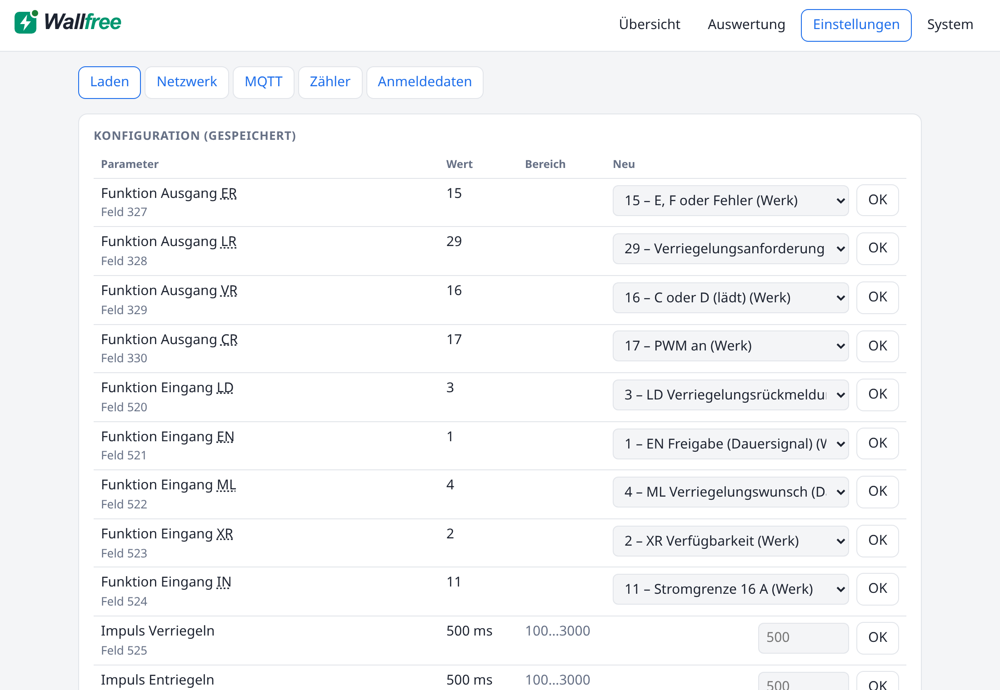
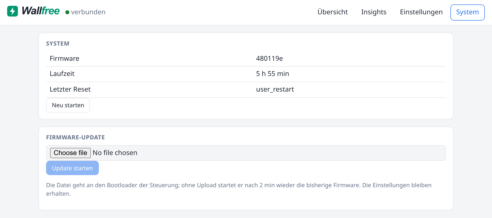
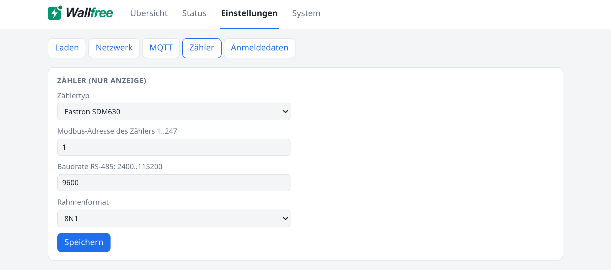
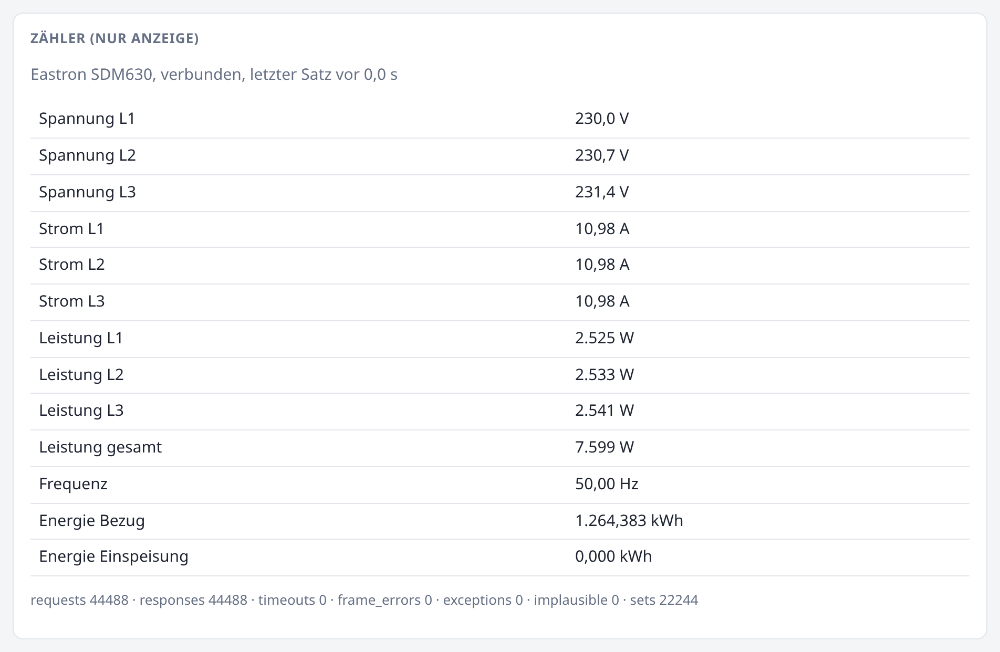
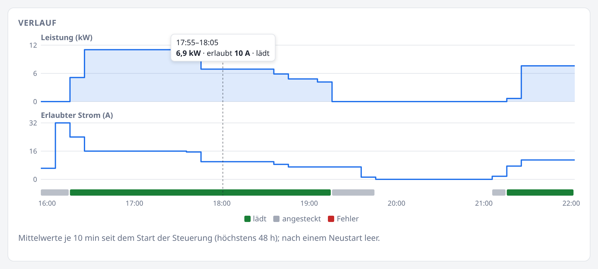
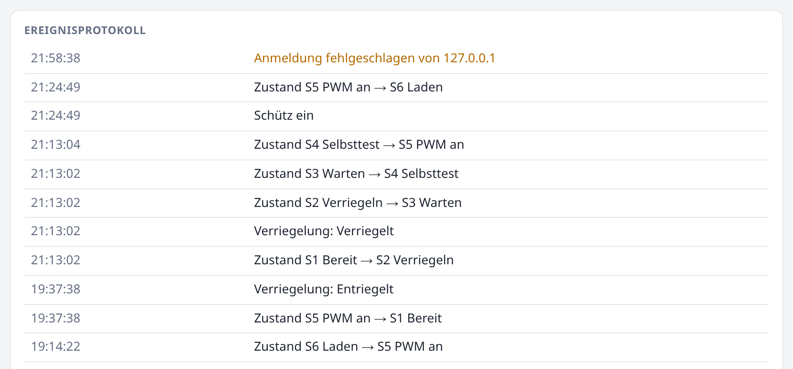

# Weboberfläche vorher und nachher

Was aus den Seiten der Originaloberfläche (wallbe-Firmware SL-01.04.24) in Wallfree wird. Die
Beschreibung der Originalseiten ist in eigenen Worten gehalten; die Bilder zeigen Wallfree in der
Simulation mit Expertenansicht. Bedienung im Einzelnen:
[Bedienungsanleitung](anleitung/weboberflaeche.md).

## Auf einen Blick

| | Original | Wallfree |
| --- | --- | --- |
| Aufbau | fünf einzelne Seiten mit Textlinks, Formularfelder, englisch | eine Seite mit Reitern (Übersicht, Status, Einstellungen, System), deutsch, auch auf dem Handy bedienbar |
| Anmeldung | keine | Benutzer und Passwort (Digest), beim ersten Aufruf zu ändern |
| Aktualisierung | Kästchen „Auto Refresh“ lädt die Seite neu | Live-Daten über WebSocket; Punkt am Logo zeigt die Verbindung |
| Speichern | ein Knopf je Seite für alles, danach Neustart empfohlen | jede Einstellung einzeln mit OK; Bereich, Werkseinstellung und Erklärung am Feld, dazu, ob sie sofort oder nach einem Neustart wirkt; Werte außerhalb des Bereichs werden mit Meldung abgelehnt |
| Verlauf und Fehler | nur der aktuelle Zustand | Verlauf über 48 h, Fehler seit dem Start, Ereignisprotokoll über Neustarts |
| Firmware-Update | Knopf übergibt an den Bootloader, Upload auf dessen Seite von Hand | geführter Ablauf mit Vorprüfung der Datei und Prüfung des Ergebnisses |

## Seite für Seite

### Status

**Original:** Zustand als Buchstabe (A..F), Ladestrom, Fernvorgabe als Zahl in A, Strombelastbarkeit
des Kabels, Ladedauer; darunter die Funktionen der fünf Eingänge und vier Ausgänge als Auswahllisten
mit Kästchen für den Pegel.

**Wallfree:** Die **Übersicht** zeigt den Zustand im Klartext mit dem Zustand des Fahrzeugs, den
erlaubten Strom und das Schütz, Fehler und Verriegelung, die Zählerwerte, Tasten für die
Stromvorgabe und die letzten Ereignisse.

Die Funktionen der Ein- und Ausgänge stehen unter **Einstellungen → Laden**, die Pegel unter
**Status → Ladelogik** (beides Expertenansicht). Auf dem Handy:

### Network

**Original:** MAC, DHCP, Adresse, Maske und Gateway in je vier Feldern, Gerätename, Seriennummer.

**Wallfree:** **Einstellungen → Netzwerk** mit DHCP oder fester Adresse, Hostname, Zeitserver
und dem Schalter für die Telnet-Shell. Aktive Adresse und Uhrzeit zeigt **Status → Verbindungen**,
die MAC-Adresse steht unter System.

### Config

**Original:** voreingestellter Ladestrom, DIP-Schalter als graue Kästchen, Zeiten der gepulsten
Verriegelung, Schützüberwachung, eine Liste weiterer Schalter (Freigabe, 5 %, Fahrzeuge in
Zustand D ablehnen u. a.) und der Knopf zum Firmware-Update.

**Wallfree:** Drehschalter und eingeschaltete DIP-Schalter stehen unter **Status → Ladelogik**. Alle
Parameter der Ladelogik stehen unter **Einstellungen → Laden**, gruppiert, mit Bereich,
Werkseinstellung und Erklärung:

Das Firmware-Update liegt unter **System**, zusammen mit Version, Laufzeit, Grund des letzten
Starts, Prüfsumme der Firmware und Neustart:

### Energy Meter

**Original:** freie Tabelle mit Modbus-Adresse, Registeranzahl, Umrechnung und Datentyp für jede
Messgröße, dazu Schnittstelle und Abfragetakt.

**Wallfree:** Zählertyp aus einer Liste wählen (ABB B23, Eastron SDM630, Eastron SDM72D-M in
beiden Versionen), dazu Adresse, Baudrate und Rahmenformat; die Register kennt die Firmware.

Messwerte und Zähler der Abfragen zeigt **Status → Zähler** (Expertenansicht):

### Card Reader

**Original:** RFID-Leser mit Liste freigegebener Karten.

**Wallfree:** entfällt (kein RFID). Freigabe über den Eingang EN, die Schnittstelle oder evcc.

### Neu in Wallfree

| Seite | Inhalt |
| --- | --- |
| Status → Verlauf | Leistung, erlaubter Strom und Zustand in 10-Minuten-Mitteln über 48 h |
| Status → Verbindungen | Netzwerk, Uhrzeit, MQTT und Zähler auf einen Blick |
| Status → Ladestrom | alle Grenzen des Ladestroms und welche gerade gilt (Expertenansicht) |
| Status → Fehler | aktive Fehler und alle seit dem Start, Quittieren des Schützfehlers |
| Status → Ereignisprotokoll | die letzten 48 Einträge: Starts mit Grund, Ereignisse, fehlgeschlagene Anmeldungen; übersteht Neustarts und Updates |
| Status → CP-Oszilloskop | Verlauf des Ladesignals (Expertenansicht) |
| Einstellungen → MQTT | Broker, Themen, Home-Assistant-Erkennung |
| Einstellungen → Anmeldedaten | Benutzer und Passwort |

